# ConfluenceAI — crypto signal platform for futures traders

One tested signal a day from a trained model, checked live against the market, explained in plain words, and
followed from "should I take it?" to "how did it end?". The platform also gives a second opinion from nine AI
agents, shows every coin ranked with a confidence level, and tracks the trades you take in a portfolio.

> **Paper only. Decision support, not financial advice.** The platform never places orders; you place every trade
> on Binance yourself. Results shown are out-of-sample backtests or live paper tests, and no signal here reaches a
> 90% win rate.

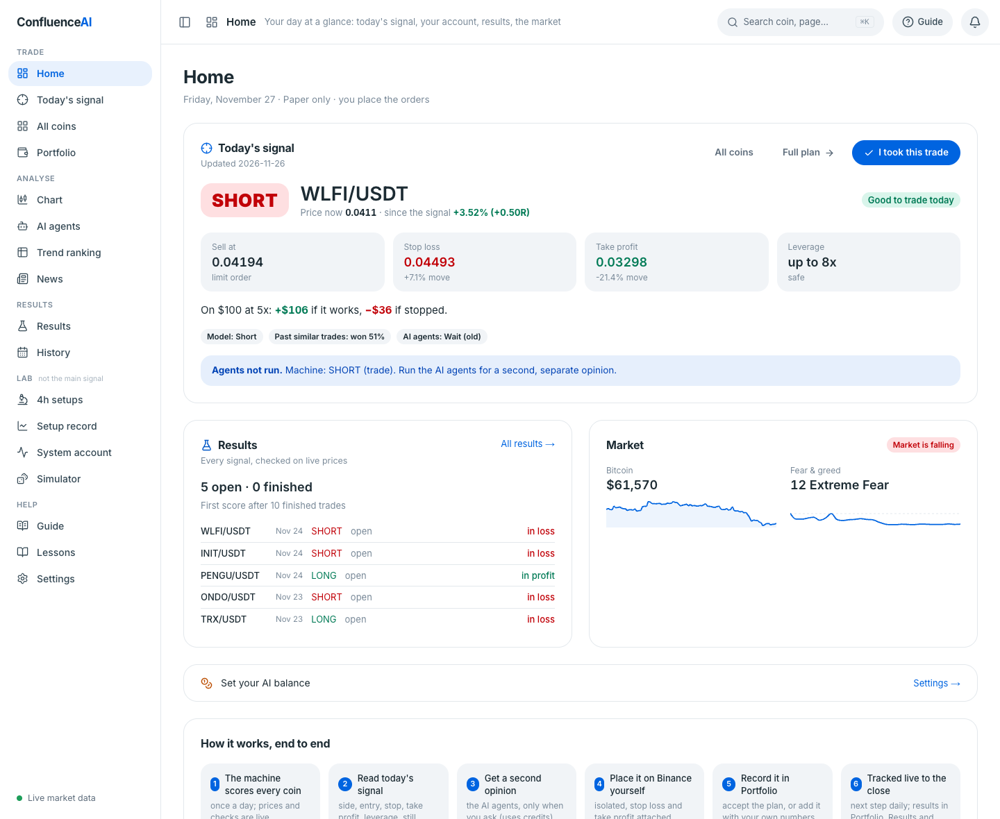

## What it does

| | |
|---|---|
| **One main signal** | A trained model (the *unified engine*) scores ~40 liquid Binance coins every day across 18 trade plans (long or short, three stop sizes, three targets) and picks the coin that stands out most. You get side, entry (market or limit), stop loss, take profit, safe leverage and the dollars at each leverage. |
| **Tested honestly** | Walk-forward by year since 2021, with a 15-day purge. The decision rule was chosen on 2020-24 only; 2025-26 is reported as it came out: **+0.08R a trade over 678 trades, 38% winners**, against −0.06R for a random coin with the same plan. Wins are about twice the size of losses, which is where the edge comes from. |
| **Live checks** | Every signal is checked against the hourly candles since it was given (stop already hit, take profit already hit, or the price ran away), so a signal that is over can never say "take it". Results are graded every minute. |
| **Three separate opinions** | The machine model, a simulation of its own past picks (with a Monte Carlo of the next 20 trades at each leverage) and the AI agents decide separately; a plain reading says whether they agree. |
| **All coins, with confidence** | Every coin the machine scores, live, as cards or a table. Confidence comes from how signals ranked like it did on unseen years, with the market's own part shown separately. Coins without a reliable side say "no clear side" instead of guessing. |
| **AI agents on demand** | Nine AI leads (chart, structure, flow, fundamentals, quant, red team, risk, validator, head trader) with 23 specialists analyse one coin when you ask. They never run on their own (they cost AI credits), and their real cost is tracked. |
| **Pre-trade check** | Before any trade is recorded, the Risk manager says *Looks fine*, *Careful* or *Not recommended*, with one line per reason (main signal agrees? still valid? confidence? agents? already holding it? drawdown? open risk?). You can still take it after confirming the warning. |
| **Portfolio** | Enter your balance once. The Risk manager picks the risk mode from the evidence (1% to start; more only after the live record earns it), sizes the trade, and tracks it live: where the price is between stop and take profit, the next step each day, and one-click closes. |
| **History and results** | Pick any day since 2021 to see the machine's trade and top 10 with outcomes; every live signal is graded and kept, losses included. |
| **Guide** | A 70-page A-to-Z guide with annotated screenshots, in the app and as a PDF. |

## Screenshots

| Today's signal | All coins |
|---|---|
| 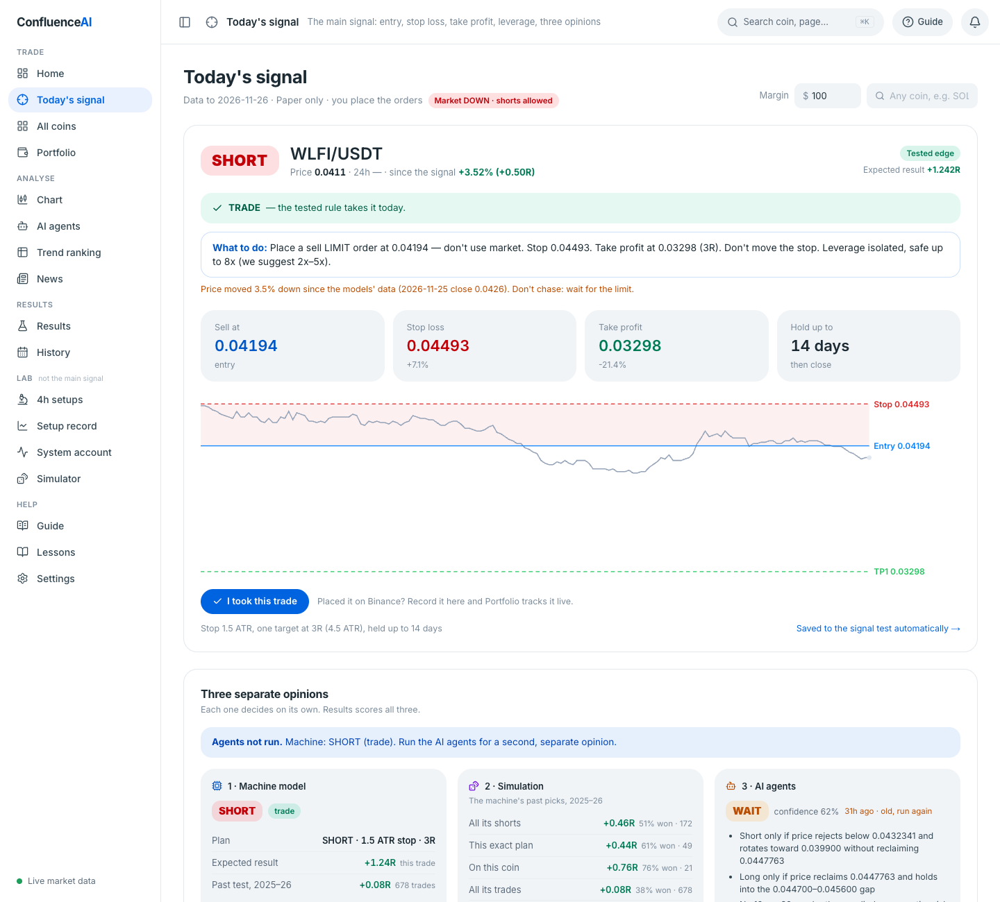 | 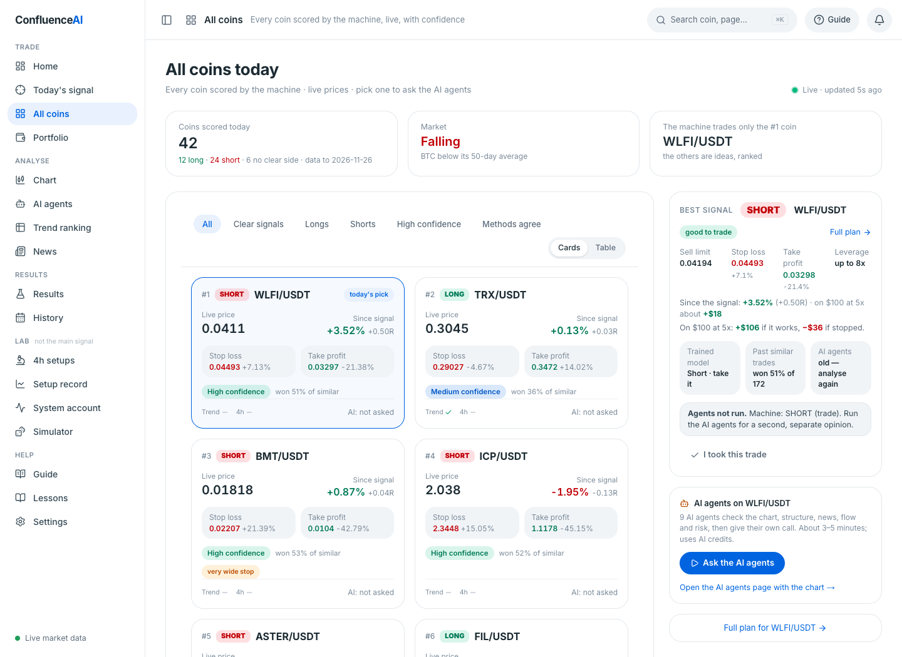 |

| Chart with the main signal drawn | AI agents |
|---|---|
| 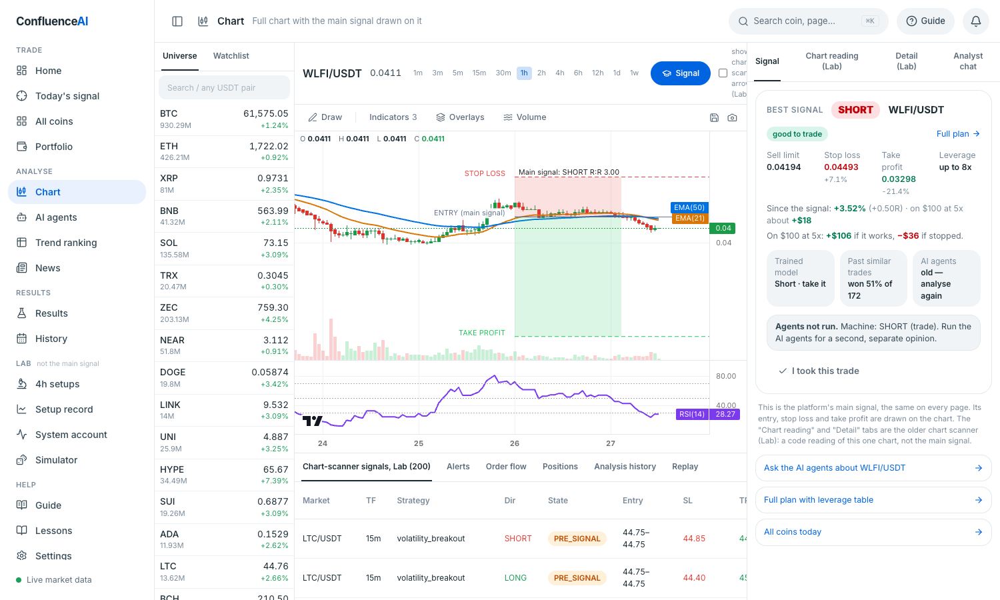 | 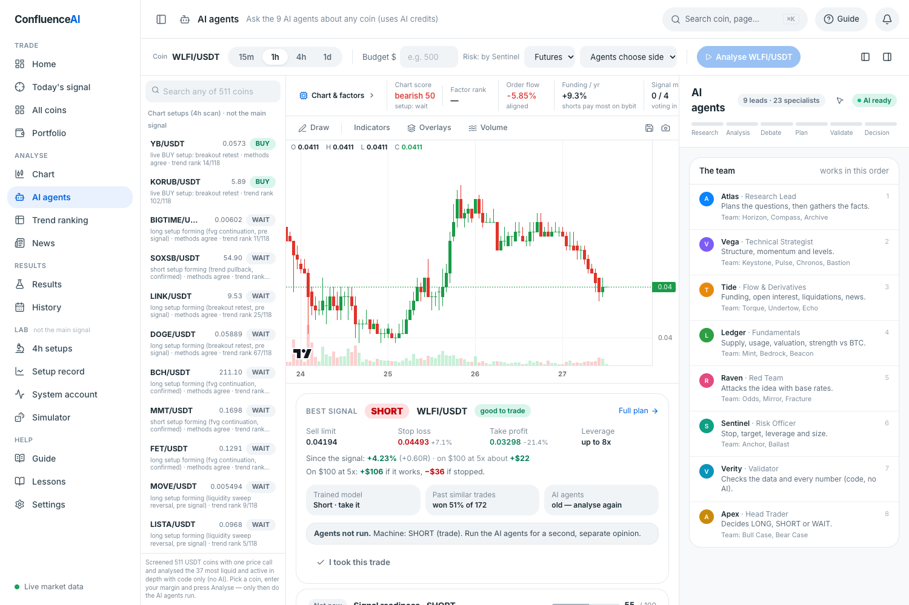 |

| Results (live paper test) | History by date |
|---|---|
| 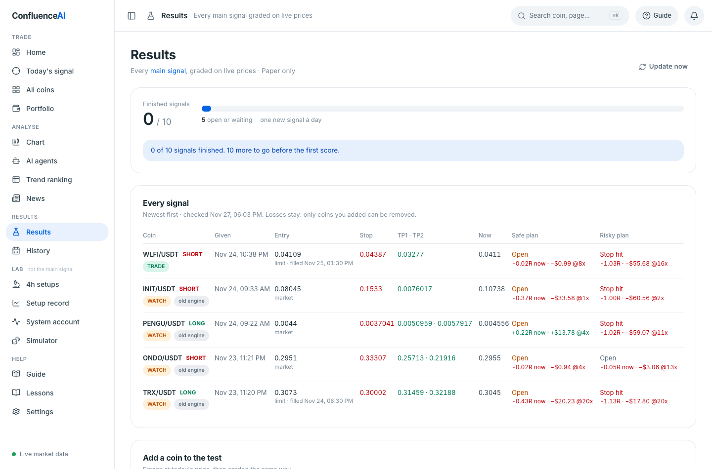 | 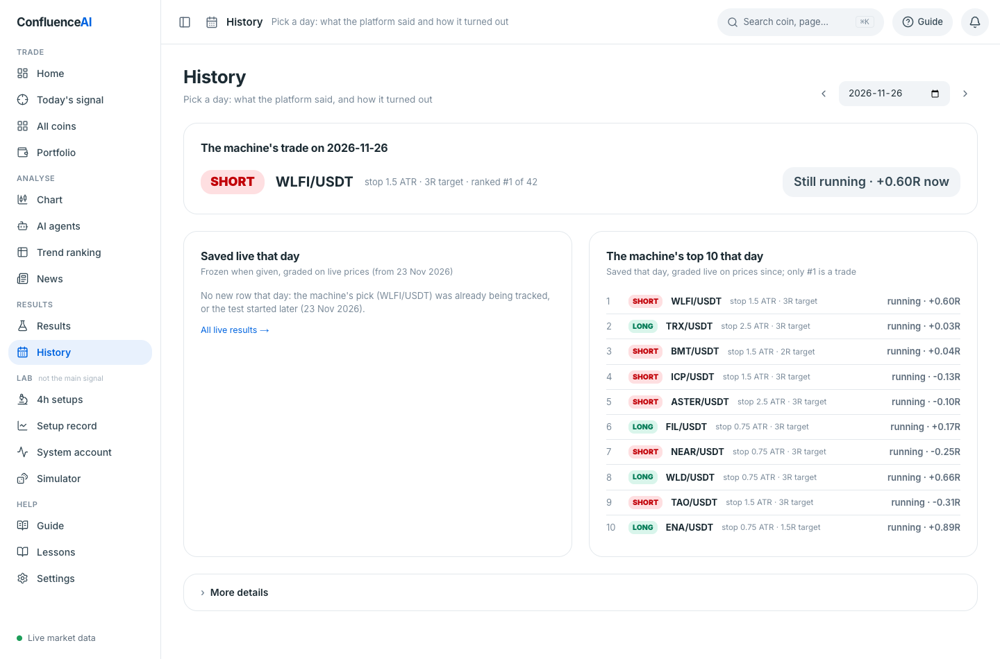 |

| Portfolio | News |
|---|---|
| 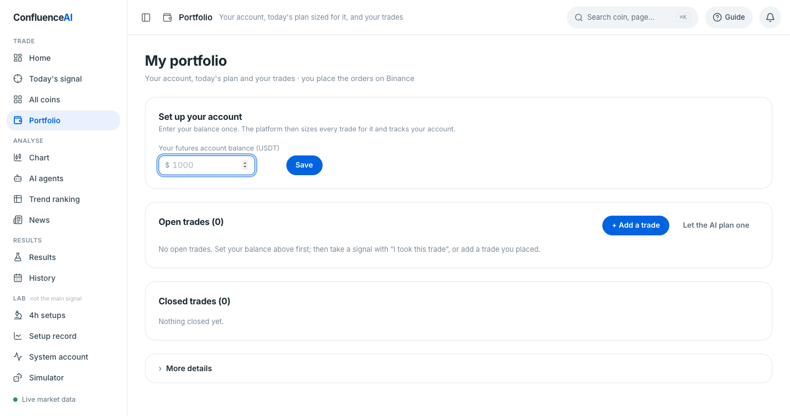 | 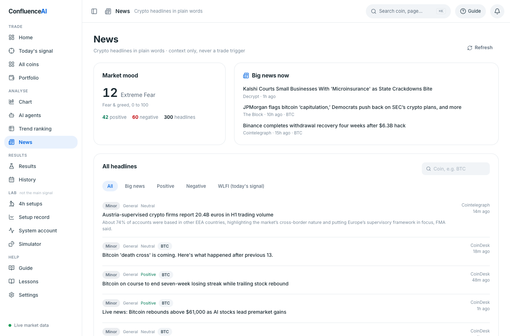 |

| Guide | Phone |
|---|---|
| 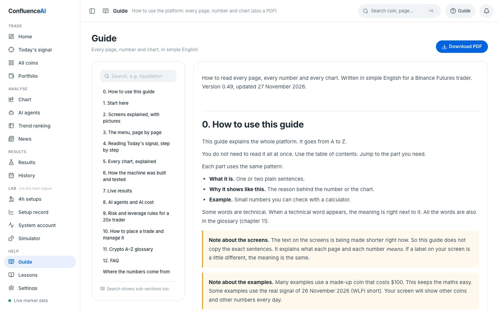 | 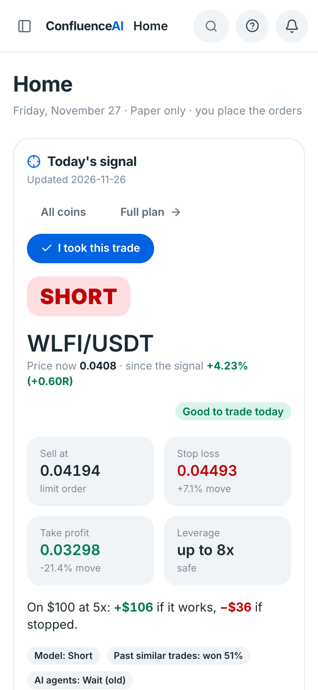 |

## How a day works

1. **The machine scores every coin** once a day after the daily close; prices, levels and live checks update all day.
2. **Read today's signal** (Home or Today's signal): side, entry, stop loss, take profit, safe leverage, still valid?
3. **Get a second opinion** if you want: All coins for context, the AI agents on one coin (only when you ask).
4. **Place it on Binance yourself**: isolated margin, stop loss and take profit attached.
5. **Record it**: *I took this trade* on any signal — sized by the Risk manager, with your own margin and leverage, or as the agents planned.
6. **It is tracked live to the close**; results show in Portfolio, Results and History.

## How the signal is built

```
Binance daily data (591 coins, 2017-2026)
  -> features: market and factors, 21 technical indicators, learned chart patterns
  -> 18 plan models (LightGBM): the R each plan will make on each coin
  -> one decision rule (chosen on 2020-24 among 8): the coin that stands out against the rest
  -> the signal: levels at the live price, leverage table, the model's own reasons (TreeSHAP by concept group)
  -> live checks, simulation of its past picks, AI agents' verdict -> one plain reading
```

Tested and **rejected** (kept in the docs with numbers): 35 human trading concepts as features (worse on unseen
years), and a meta-labeling filter on the engine's own picks (Sharpe 2.97 on the choosing years, 0.48 on unseen
ones). The AI agents can't be backtested honestly (a language model has read the history), so their role is decided
forward by a rule written before any data: after 30 graded signals they get a veto only if listening to them clearly
paid. Details: [docs/ML_RESEARCH.md](docs/ML_RESEARCH.md) §12-14.

## Run it locally

Requirements: Python 3.12 with [uv](https://docs.astral.sh/uv/), Node 20+.

```bash
# backend: API + the always-on engine (SQLite, data in backend/data/)
cd backend
uv sync
uv run uvicorn app.main:app --port 8100

# frontend
cd ../frontend
npm install
echo 'NEXT_PUBLIC_API_URL=http://localhost:8100' > .env.local
npm run build && PORT=3100 npm run start        # open http://localhost:3100
```

Optional AI agents: put `AIT_OPENAI_API_KEY=...` (or `AIT_ANTHROPIC_API_KEY=...`) in `backend/.env` and restart the
backend. Everything except the AI agents works without a key. Never put keys in the frontend.

Rebuild the models (monthly retrain runs by itself): `uv run python -m app.ml.unified`.
Tests: `cd backend && uv run pytest -q` (450 tests; they never write the real data folder) · lint: `uv run ruff check app` and `cd frontend && npx eslint src`.

## Project layout

| Path | What is there |
|---|---|
| `backend/app/ml/` | The unified engine (`unified.py`), plans (`style.py`), simulation, live checks, signal test, history, board |
| `backend/app/agents/` | The AI research desk, its tools and validators, cost tracking |
| `backend/app/portfolio/` | Your trades, the account and the Risk manager (`manager.py`) |
| `backend/app/api/` | REST API (FastAPI) |
| `frontend/src/app/` | Pages (Next.js): Home, Today's signal, All coins, Portfolio, Chart, AI agents, Results, History, News, Lab, Guide |
| `docs/` | Research, strategies, architecture and the guide (`docs/guide/Platform-Guide.pdf`) |

## Documentation

| Document | Contents |
|---|---|
| [docs/guide/Platform-Guide.pdf](docs/guide/Platform-Guide.pdf) | The A-to-Z user guide (also in the app at `/guide`) |
| [CHANGELOG.md](CHANGELOG.md) | Every release, with its test results |
| [docs/ML_RESEARCH.md](docs/ML_RESEARCH.md) | How the models were built and tested, including what was rejected |
| [docs/ARCHITECTURE.md](docs/ARCHITECTURE.md) | System design and data flow |
| [docs/STRATEGIES.md](docs/STRATEGIES.md) | Strategy specs and backtest results (Lab systems) |
| [docs/API_DOCUMENTATION.md](docs/API_DOCUMENTATION.md) | REST and WebSocket API |
| [docs/SECURITY.md](docs/SECURITY.md) · [docs/TESTING.md](docs/TESTING.md) · [docs/DEPLOYMENT.md](docs/DEPLOYMENT.md) | |

Charts use TradingView Lightweight Charts™ (Apache-2.0, attribution logo shown on the chart).
