# ConfluenceAI: the A to Z guide

How to read every page, every number and every chart. Written in simple English for a Binance Futures trader. Version 0.49, updated 27 November 2026.

[TOC]

# 0. How to use this guide

This guide explains the whole platform. It goes from A to Z.

You do not need to read it all at once. Use the table of contents. Jump to the part you need.

Each part uses the same pattern:

- **What it is.** One or two plain sentences.
- **Why it shows like this.** The reason behind the number or the chart.
- **Example.** Small numbers you can check with a calculator.

Some words are technical. When a technical word appears, the meaning is right next to it. All the words are also in the glossary (chapter 11).

> **Note about the screens.** The text on the screens is being made shorter right now. So this guide does not copy the exact sentences. It explains what each page and each number *means*. If a label on your screen is a little different, the meaning is the same.

> **Note about the examples.** Many examples use a made-up coin that costs $100. This keeps the maths easy. Some examples use the real signal of 26 November 2026 (WLFI short). Your screen will show other coins and other numbers every day.

# 1. Start here

## 1.1 What the platform does, in 5 lines

1. Every day, it looks at about 40 to 45 big Binance coins (the coins with enough daily trading).
2. One trained computer model (the "machine") picks **one coin and one plan**: long or short, entry, stop, target.
3. It shows you how much you can win or lose with your margin at each leverage.
4. It tests itself honestly: on past years it never saw, and on live prices from today on.
5. If you want a second opinion, a team of AI agents can study the same coin. This costs AI credits, and it only runs when you press the button.

## 1.2 One main signal, and the Lab

The platform has **one main signal**. It is on the page **Today's signal**. It is also at the top of **Home**.

Everything else is either a tool (Markets, Chart, Portfolio) or the **Lab**.

The **Lab** holds older systems: the 4h setups, the Setup record, the System account and the Simulator. They are kept for research and comparison. Every Lab page has a LAB banner. **A Lab result is never the main signal.** If a Lab page and Today's signal disagree, Today's signal is the one that was tested the most.

## 1.3 Paper only: you place the orders

- The platform **never** sends an order to Binance.
- It never asks for your exchange API keys. It cannot trade for you.
- "Paper" means the trades are only written down and graded. No real money moves.
- If you want a real trade, you open Binance and place it yourself. That decision is yours.

## 1.4 The honest numbers (read this first)

> **The main signal does NOT win 90% of the time.** No signal on this platform reaches 90%. Here is what the main signal did on 2025–26, years the machine never saw while it was built:
>
> - It made money on **38%** of trades. So about 6 of every 10 trades lost.
> - An average winning trade made about **+1.8R**. An average losing trade lost about **−0.9R**. (R = the amount you lose if the stop hits. See section 4.7.)
> - Together: about **+0.08R per trade** on average, over 678 trades.
> - The true average could be anywhere from **−0.06R to +0.23R** (90% range). So it is possible the real edge is zero.
> - **Shorts carried the result** (+0.46R a trade). Longs were slightly negative (−0.05R a trade).
> - The edge is getting smaller: +0.27R in 2023, +0.11R in 2025, +0.05R in 2026.

So: the platform does not win by being right often. It wins (a little) because its wins are bigger than its losses.

### Why not aim for a 90% win rate?

You *can* make a very high win rate. You just set a very close take-profit. But then each win is tiny, and one loss takes away many wins.

The platform tested this. With a take-profit only +3% away, the win rate of an older signal went from 47% to 84%. But the average trade went from +0.40% to −0.23%. The whole test book went from +104% to −100%. A DCA bot (a bot that keeps buying more as price falls) had a 98.9% win rate and still lost 36%.

> **Win rate alone tells you nothing.** You must look at win rate *and* the size of wins and losses together. The platform calls this the average R, or expectancy.

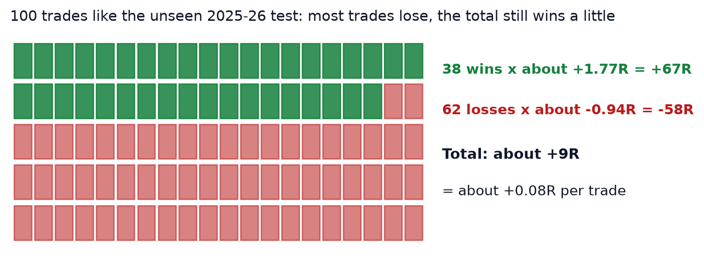

# 2. Screens explained, with pictures

This chapter shows the real screens. Each picture has **pink numbered circles** with arrows. Under each picture, the list explains every number the same way:

**number — what it is · what it means for you · what to do with it**

> **About the numbers in the pictures.** The pictures were taken on 26 November 2026 (signal: WLFI/USDT short). Prices move every minute, so a number in a picture can be a little different from the same number in the text of other chapters. Your screen will show other coins and numbers every day. The *meaning* is the same.

## 2.1 Home: today's signal

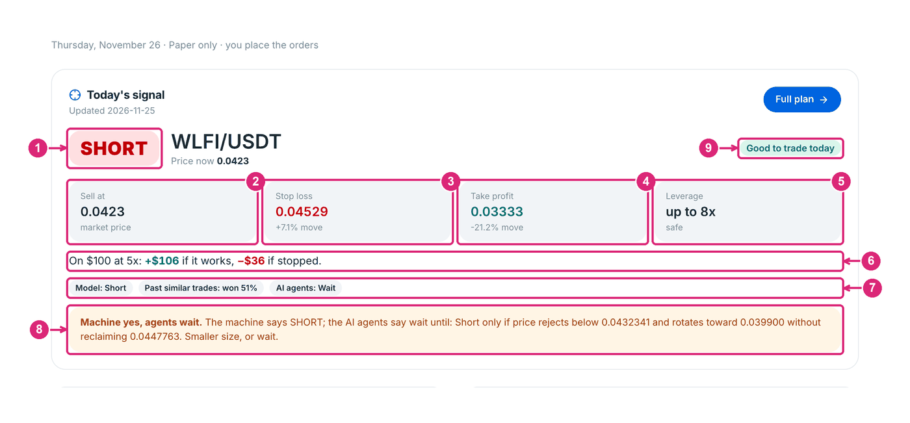

1. — **Side: SHORT or LONG.** · SHORT means you win if the price goes **down**. LONG means you win if it goes **up**. · On Binance, SHORT = "Sell/Short", LONG = "Buy/Long".
2. — **Sell at (or Buy at).** · The entry price. "market price" means enter now; "limit" means wait for that price. · Use the same order type on Binance.
3. — **Stop loss** and its % move. · If the price reaches it, the idea was wrong and you lose 1R. · Put this as your Stop Loss on Binance **at the same time** as the entry.
4. — **Take profit** and its % move. · Where the whole trade is closed with a win (usually 3R). · Put this as your Take Profit on Binance.
5. — **Leverage: up to Nx (safe).** · The highest leverage where liquidation stays far behind your stop. · Never go above it. Lower is fine.
6. — **The money line.** · What $100 margin at 5x wins if the take profit hits, and loses if the stop hits (fees included). · Ask yourself: "Can I accept the loss number?"
7. — **Three chips: Model · Past similar trades · AI agents.** · The three separate opinions in one line (chapter 4.13). "Won 51%" = how often the model's past picks like this made money on unseen years. · Read them together.
8. — **The final reading.** · How the three opinions line up. Here: "Machine yes, agents wait". · Green = both agree. Amber = smaller size or wait. Red = skip.
9. — **Good to trade today.** · The tested rule takes this trade today (TRADE). If it says watch only, the rule would not trade it. · Trade only when it is green.

## 2.2 Home: live results, market and AI balance

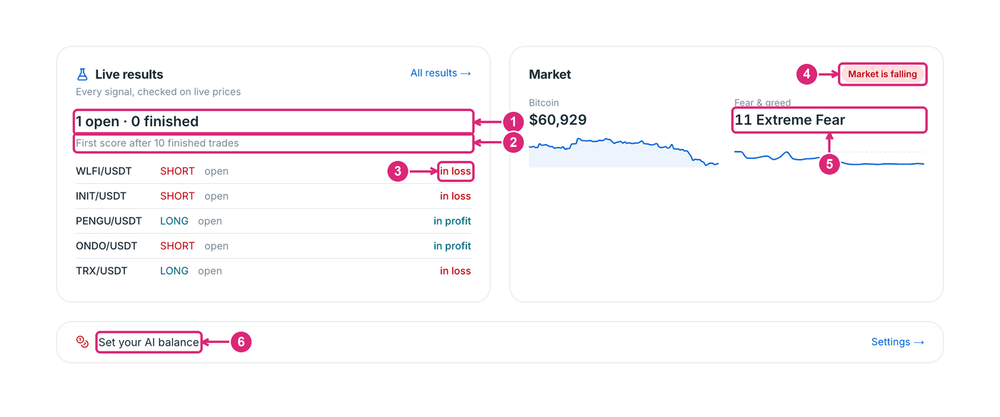

1. — **"1 open · 0 finished".** · How many main signals are still running and how many are finished. · Just watch it grow.
2. — **"First score after 10 finished trades".** · There is no score yet, because 10 trades are too few to judge. · Don't judge the system after 2 or 3 trades.
3. — **"in loss" / "in profit".** · Where each open signal stands at the live price now. It can change many times before it closes. · Do not close a trade just because it is "in loss" today.
4. — **"Market is falling" (or rising).** · Bitcoin is below (or above) its 50-day average. · Be extra careful with LONG trades when the market is falling.
5. — **Fear & greed (11 Extreme Fear).** · The mood of the market from 0 to 100 (chapter 5.3). · Context only, not a buy or sell signal.
6. — **Set your AI balance.** · A small tile for your AI credits. The full card is in Settings (picture 2.13). · Enter your balance there once.

## 2.3 Today's signal: the main card

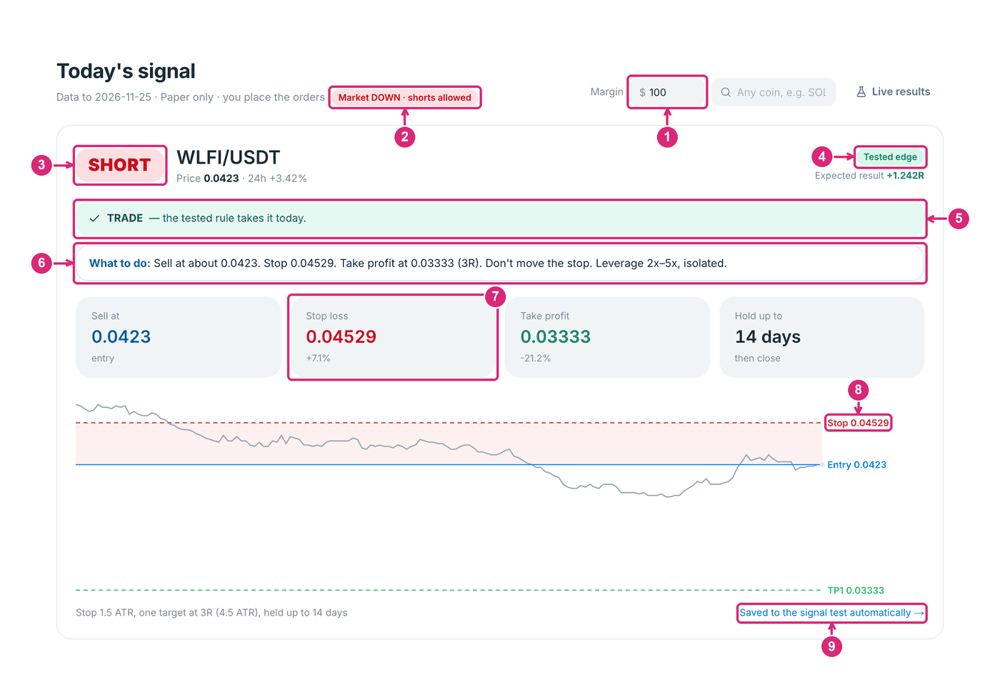

1. — **Margin box.** · The money you plan to put on the trade. All dollar numbers on the page follow it. · Type your real margin (for example 100).
2. — **Market DOWN · shorts allowed.** · BTC is below its 50-day average. · In a falling market, longs did badly in tests.
3. — **SHORT and the coin.** · The side and the coin of the one main signal. · Open the same side on Binance.
4. — **Tested edge + Expected result.** · The badge says the method made money on unseen years. "Expected result" is the model's forecast for this one trade (a ranking number, not a promise; chapter 4.2). · Trust the tested record more than the forecast.
5. — **TRADE — the tested rule takes it today.** · Green = trade. Amber "WATCH ONLY" = the rule would not take it. · Only trade green days.
6. — **What to do.** · The whole order in one sentence: side, entry, stop, take profit, leverage range. · Copy this into Binance.
7. — **The level tiles (Sell at · Stop loss · Take profit · Hold up to).** · The four numbers of the plan. "Hold up to 14 days, then close". · Write them down before you open Binance.
8. — **The plan chart.** · Grey line = the price of the last 7 days. Red dashed = stop. Blue = entry. Green dashed = take profit (TP1). · Look: has the price often touched the stop level in the last days?
9. — **Saved to the signal test automatically.** · This signal is graded on live prices (Live results). · Check it there later.

## 2.4 Today's signal: the three opinions

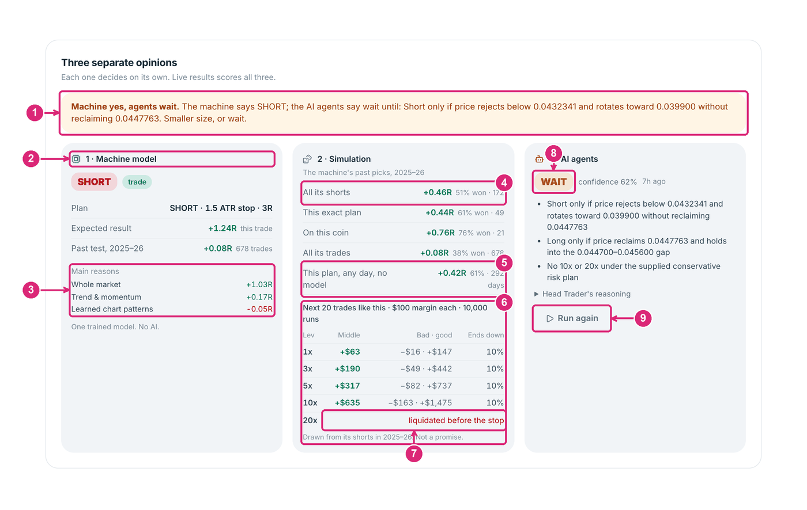

1. — **The final reading.** · Here: "Machine yes, agents wait", with the agents' condition. · Amber = smaller size, or wait for the condition.
2. — **1 · Machine model.** · The trained model's call: side, trade or watch, plan (for example "SHORT · 1.5 ATR stop · 3R"), expected result, past test. · This is the main signal.
3. — **Main reasons.** · The 3 strongest reasons the model saw, in R (green helps, red hurts). · Ask: "Do I believe these reasons?"
4. — **All its shorts.** · How the model's past shorts did on unseen 2025–26: average R, % won, number of trades. · Bigger counts are more reliable.
5. — **This plan, any day, no model.** · The same plan on this coin on every day, without the model choosing. · If the model's lines are not better than this, the model adds little here.
6. — **Next 20 trades like this.** · A Monte Carlo of 20 future trades at each leverage: middle, bad · good, and the chance to end down (chapter 4.15). · Look at the "bad" number: can you live with it?
7. — **liquidated before the stop.** · At 20x the exchange would close you before your stop. · Never use that leverage for this plan.
8. — **3 · AI agents: WAIT, confidence, age.** · The AI team's separate verdict. It counts for 24 hours. · Read their conditions. They advise; the machine decides (chapter 7.5).
9. — **Run again.** · Starts a new AI agent run. **It costs AI credits** (about 3–5 minutes). · Press only if you want a fresh opinion and have credits.

## 2.5 Today's signal: your margin at each leverage

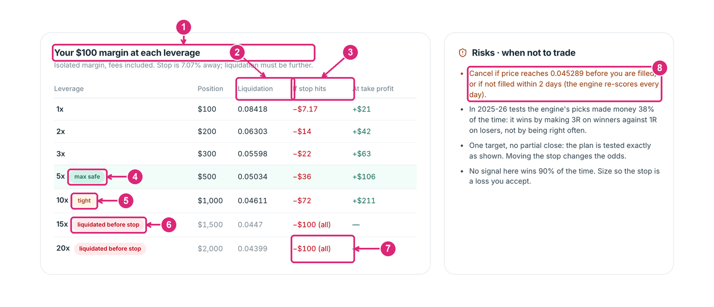

1. — **Your $100 margin at each leverage.** · One row per leverage, isolated margin, fees included. · Find your leverage row and read its two dollar numbers.
2. — **Liquidation.** · The price where Binance closes you and you lose the whole margin. · It must be further away than your stop.
3. — **If stop hits / At take profit.** · Your loss at the stop and your win at the take profit, in dollars. · Choose the row whose loss you accept.
4. — **max safe.** · The highest safe leverage shown in the table. · Do not go higher than this row.
5. — **tight.** · Liquidation is just after the stop. A wick could liquidate you. · Avoid it.
6. — **liquidated before stop.** · The exchange closes you before your stop. · Never use these rows.
7. — **−$100 (all).** · At that leverage you lose your whole margin, not just 1R. · This is why 20x is "not possible" for this plan.
8. — **Risks · when not to trade.** · When to cancel (stop reached before fill, no fill in 2 days) and other warnings. · Read it every time.

## 2.6 Today's signal: More details — why this trade, and the past test

Open the **"More details"** bar at the bottom of the page to see this.

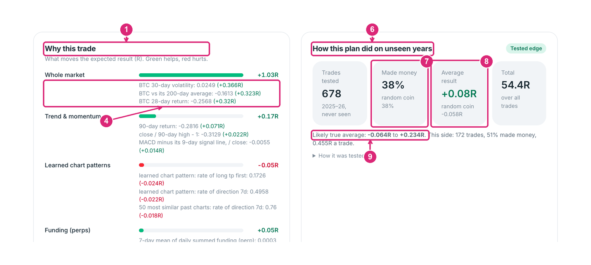

1. — **Why this trade.** · The model's own reasons, grouped. · Read the top 2–3 groups.
2. — **Whole market.** · The biggest group here: the whole market is weak. · This trade depends on the market staying weak.
3. — **+1.03R.** · How much this group adds to the expected result. Green helps, red hurts. · Longer bar = stronger reason.
4. — **The inputs under a group.** · The real numbers the model read (for example BTC 28-day return −26%). · Check that they make sense to you.
5. — **−0.05R (red).** · A small reason *against* the trade (here: similar past chart shapes). · Small red bars are normal.
6. — **How this plan did on unseen years.** · The honest test of the same method on 2025–26. · This is the number to trust.
7. — **Made money 38% (random coin 38%).** · How often the picks won, next to a random coin. · Same win rate as random…
8. — **Average result +0.08R (random coin −0.058R).** · …but a better average: the wins were bigger. · This is the real edge, and it is small.
9. — **Likely true average −0.064R to +0.234R.** · The 90% range. It includes zero. · Size small: the edge could be zero.

## 2.7 Today's signal: More details — the risky 10–20x option

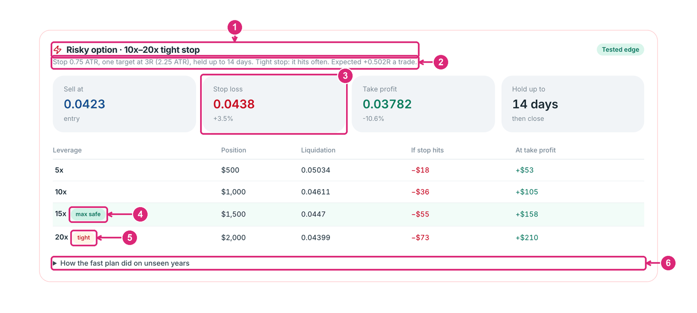

1. — **Risky option · 10x–20x tight stop.** · The same idea with a much closer stop, for high leverage. · Only if you accept many more stop-outs.
2. — **Stop 0.75 ATR, one target at 3R, held up to 14 days.** · The stop is smaller than one normal day's move. "Tight stop: it hits often." · Expect more losses in a row.
3. — **Stop loss tile (+3.5%).** · The close stop. · Put it on Binance with the entry, like the main plan.
4. — **max safe (15x).** · With this close stop, up to 15x keeps liquidation behind the stop. · Do not go above it.
5. — **tight (20x).** · Liquidation is just after the stop. · Avoid.
6. — **How the fast plan did on unseen years.** · Click to see its own test. · Read it before you use this option.

## 2.8 AI desk: the whole screen

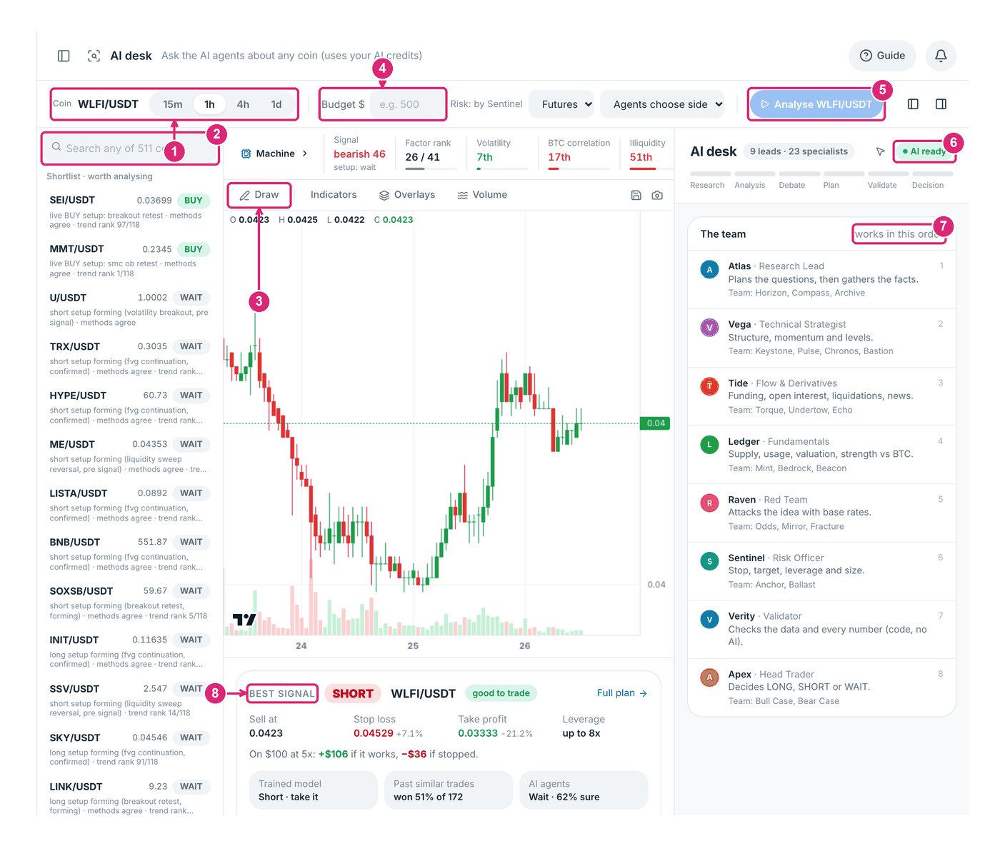

1. — **Coin and timeframe.** · The coin the desk looks at, and the chart timeframe (15m, 1h, 4h, 1d). · Pick a coin first.
2. — **Search and shortlist.** · Any of about 500 coins, and a shortlist made by code (free, no AI). · Use it to find a coin to look at.
3. — **The chart with drawing tools.** · Draw, indicators, overlays, volume. · Look at where the stop would sit.
4. — **Budget $.** · Your trading budget. Sentinel (the Risk Officer) uses it for the size. · Enter it before a run.
5. — **Analyse (coin).** · Starts the AI agents. **It costs AI credits**, about 3–5 minutes. · Press only when you want their opinion.
6. — **AI ready** (green) or **AI off** (red). · Whether the AI can run now. "AI off" with a red banner such as "no credits remaining" means your AI balance is empty; the free parts still work. · Top up at your AI provider if you want the agents.
7. — **The team.** · The 9 AI leads in the order they work (chapter 8.1). · Just for information.
8. — **Best signal.** · The best plan for this coin in one card (next picture). It is free and shows before any run. · Read it first.

## 2.9 AI desk: the Best signal card

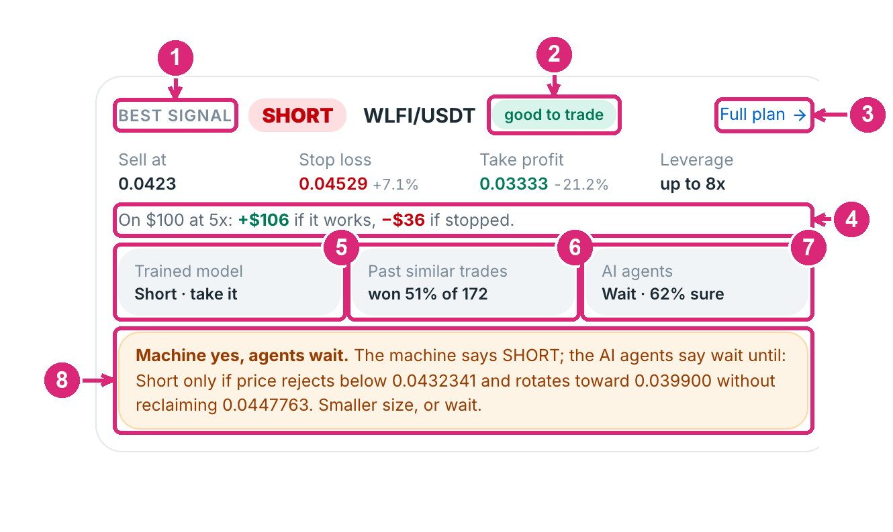

1. — **BEST SIGNAL + side + coin.** · The trained model's plan for the coin you picked. · Same meaning as on Home.
2. — **good to trade.** · The tested rule would take it today. · If not, it is watch only.
3. — **Full plan.** · Opens Today's signal for this coin, with the leverage table. · Open it before you trade.
4. — **The money line.** · $100 at 5x: what you win and what you lose. · Can you accept the loss?
5. — **Trained model.** · The model's call ("Short · take it"). · The main opinion.
6. — **Past similar trades.** · The model's past picks like this: won 51% of 172. · Bigger counts = more reliable.
7. — **AI agents.** · Their latest verdict and confidence ("Wait · 62% sure"). · Advice, not a command.
8. — **The plain reading.** · How the three line up, in one sentence. · Amber = smaller size or wait.

After an AI run, the **Plan** tab shows this card first, then **"The AI agents' own plan"** (Sentinel's stop, target, leverage and size).

## 2.10 Live results

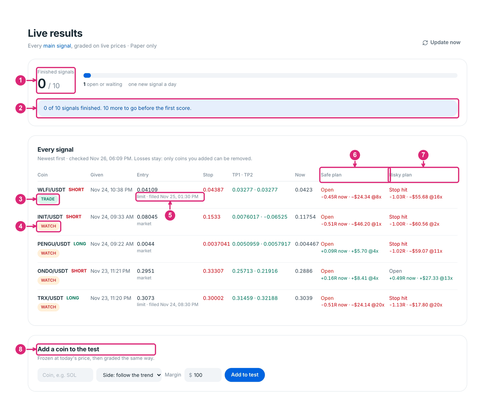

1. — **Finished signals 0 / 10.** · Progress to the first score. · Wait for 10, and trust it only after 50–100.
2. — **"0 of 10 signals finished…"** · The score line. After 10 it says "working", "making money but less than the backtest", or "losing money so far". · Read it once a week.
3. — **TRADE chip.** · The rule took this signal. · These are the ones that count most.
4. — **WATCH chip.** · The rule would not have taken it; it is graded anyway, for comparison. · TRADE should do better than WATCH over time.
5. — **"limit · filled Nov 25".** · How the entry filled: market, or limit and when. · A limit not filled in 48 hours counts as "not filled".
6. — **Safe plan.** · The main plan's result: open / stop hit / target hit, R now, and dollars at the safe leverage. · This is the main score.
7. — **Risky plan.** · The tight-stop option's result. · On 26 Nov, the risky option had hit its stop on all 4 of its finished signals: tight stops get hit often.
8. — **Add a coin to the test.** · Freeze a plan for any coin and grade it the same way. · Optional. It saves to the record, so only use it when you mean it.

## 2.11 Live results: More details

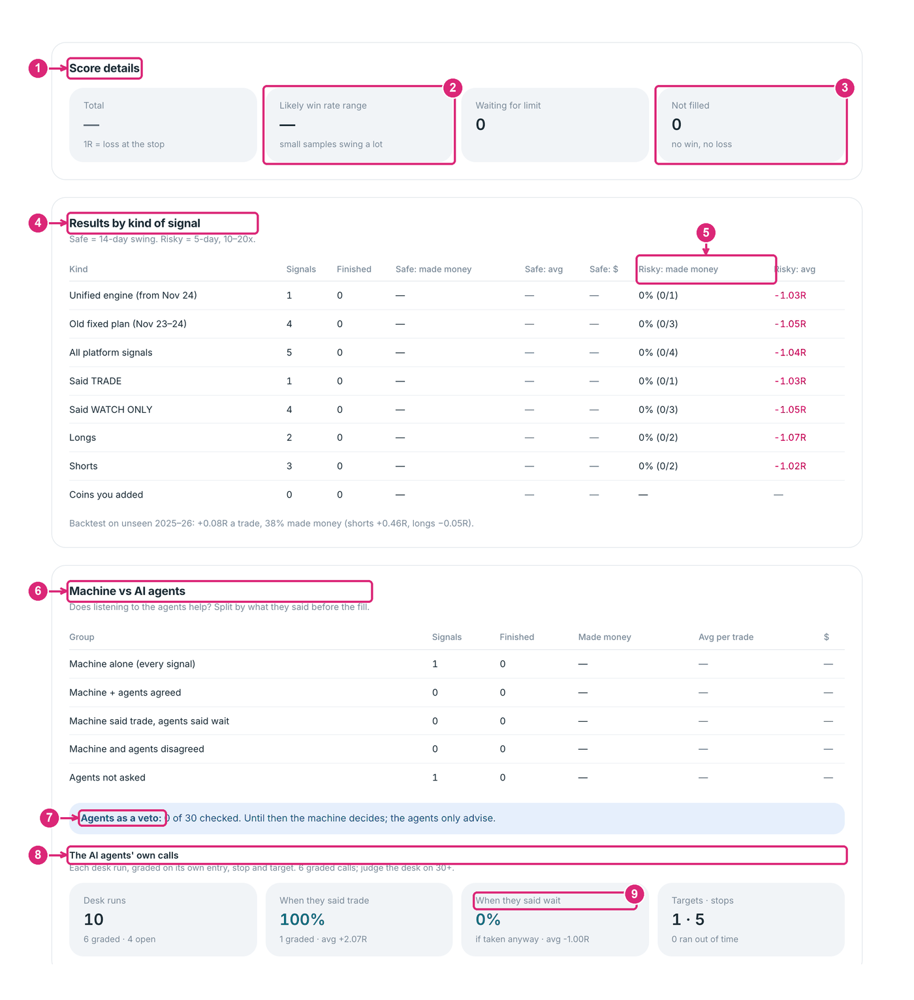

1. — **Score details.** · Total R, the likely win-rate range, limits waiting, not filled. · Look at the range: small samples swing a lot.
2. — **Likely win rate range.** · The 90% range of the true win rate. · Wide range = not enough trades yet.
3. — **Not filled.** · Limit orders that never filled (no win, no loss). · Normal; it means the price never came back.
4. — **Results by kind of signal.** · The same score split: current engine vs old plan, TRADE vs WATCH, longs vs shorts, coins you added. · Check that TRADE beats WATCH and shorts behave as tested.
5. — **Risky: made money.** · How the risky tight-stop option is doing. · Here 0 of 4: a real example of why tight stops are risky.
6. — **Machine vs AI agents.** · The machine's signals split by what the agents said before the fill. · Over time this shows if listening to the agents helps.
7. — **Agents as a veto: 0 of 30 checked.** · The rule written in advance (chapter 7.5). Until 30, the machine decides. · Nothing to do; just watch.
8. — **The AI agents' own calls.** · The agents' own plans, graded on their own entry, stop and target. · Judge them after 30+ calls.
9. — **When they said wait.** · What the trades they skipped would have done. Red (here −1.00R) = they were right to wait. · Small sample; keep watching.

## 2.12 Settings: the guide and AI usage

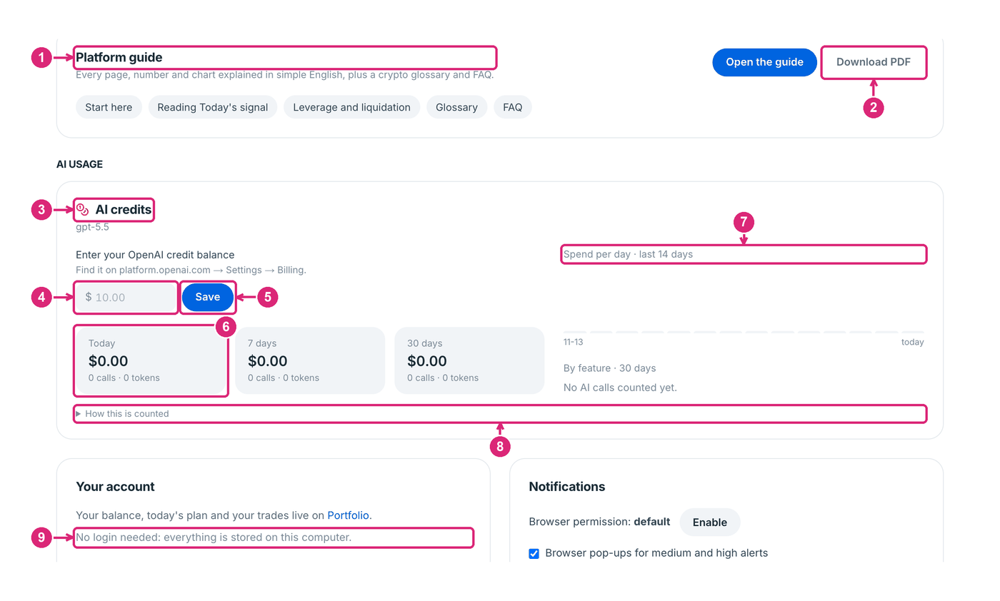

1. — **Platform guide.** · This guide, inside the app. · Open it when a word or a number is not clear.
2. — **Download PDF.** · The same guide as a PDF. · Save or print it.
3. — **AI credits.** · The AI model in use (for example gpt-5.5). · Just for information.
4. — **Your balance box.** · Type the balance you see on your AI provider's billing page. · Do it once, and again after you top up.
5. — **Save.** · Stores the AI balance. From then on the platform counts the estimated spend. · Press it only after you type your real balance.
6. — **Today / 7 days / 30 days.** · Dollars spent on AI, calls and tokens. · Check it after you run the agents.
7. — **Spend per day.** · One bar per day for the last 14 days (chapter 5.4). · Tall bar = expensive day.
8. — **By feature.** · Which part of the platform used the AI. · Most spend should be the research desk.
9. — **How this is counted.** · The price per 1 million tokens and how the estimate works (chapter 8.5). · The provider's bill is the truth.
10. — **No login needed.** · The "Your account" card: there is no login. Everything is stored on this computer. Your balance and trades are on Portfolio. · Nothing to do.

## 2.13 News

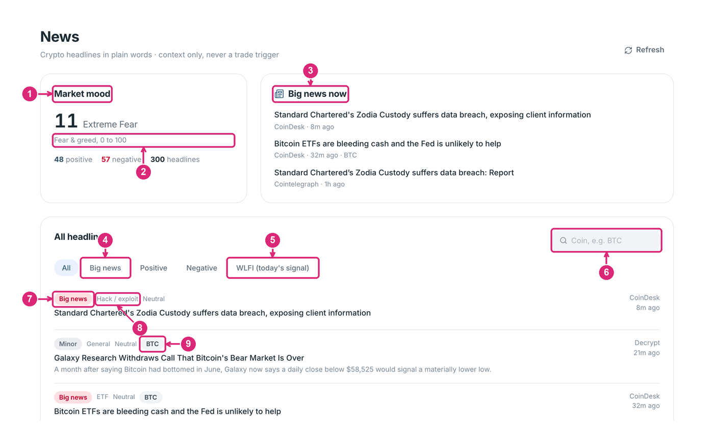

1. — **Market mood.** · The fear & greed number (0–100) and how many recent headlines were positive or negative. · Context only.
2. — **Fear & greed, 0 to 100.** · 11 = extreme fear (chapter 5.3). · Very low or very high numbers mean the crowd is emotional. Be careful, not excited.
3. — **Big news now.** · The top 3 high-impact headlines (hacks, regulation, ETF flows…). · Read them before you trade.
4. — **Filters: All · Big news · Positive · Negative.** · Show only some headlines. · "Big news" is the fastest way to check for danger.
5. — **"WLFI (today's signal)".** · Only the headlines about today's signal coin. · Check this before every trade.
6. — **Coin search.** · Find the news for any coin. · Type the coin, for example BTC.
7. — **Impact chip: Big news / Worth knowing / Minor.** · How much this headline could move prices. · Big news on your coin: think twice, or use a smaller size.
8. — **Type and mood** (for example "Hack / exploit · Neutral"). · What kind of news it is, and whether it reads as good, bad or neutral. · A hack or a regulation story on your coin is a risk.
9. — **Coin chip** (for example BTC). · Which coins the headline is about. · Look for your trade's coin.

> **News never triggers a trade.** The machine model does not trade on headlines. News is only context for you (and an input the AI agents read). "How the news is read" is under More details on the page.

## 2.14 Portfolio: set up your account (first time)

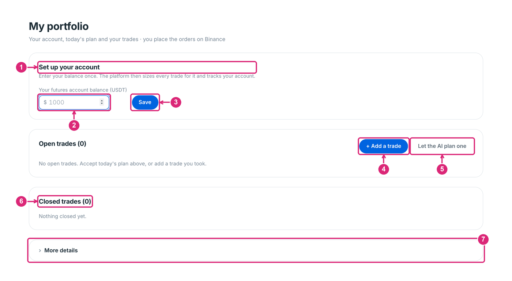

1. — **Set up your account.** · The platform needs to know your account size once. · Do this one time.
2. — **Your futures account balance (USDT).** · Type the balance of your Binance USDⓈ-M Futures wallet. · Enter the real number (you can change it later with the pencil).
3. — **Save.** · Stores it. From then on the page sizes today's signal for your account. · Press it after you type your balance.
4. — **+ Add a trade.** · A simple form to record any trade you placed, with your own numbers (picture 2.19). · Use it for trades that are not today's plan.
5. — **Let the AI plan one.** · The AI agents plan a trade for a coin you choose. **It uses AI credits.** · Optional.
6. — **Closed trades.** · Your finished trades, with the win rate and the total. · Empty at the start.
7. — **More details.** · The AI portfolio desk, the budget plan and the paper account. The AI portfolio desk runs only when you press "Ask the AI desk" (it uses AI credits). · Optional.

## 2.15 Portfolio: your account and today's plan

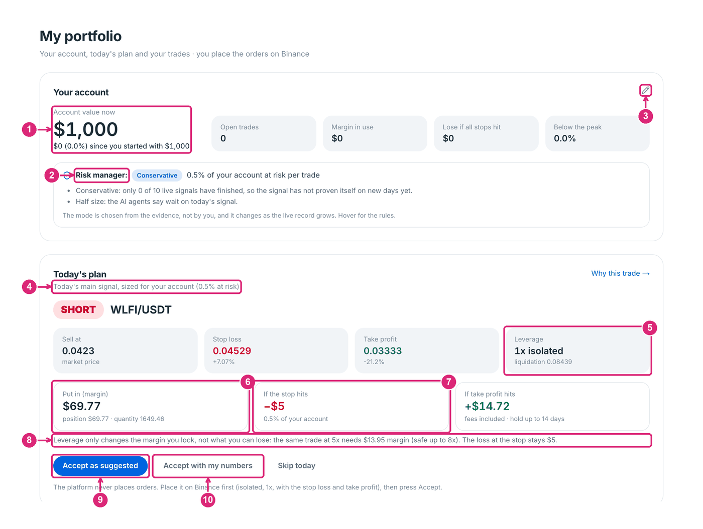

1. — **Account value now.** · Your balance plus or minus the profit and loss since you started. The tiles next to it: open trades, margin in use, "lose if all stops hit", and how far you are below your best value (the peak). · Check it every day.
2. — **Risk manager.** · Code (not you, not an AI) chooses the risk mode from the evidence, with its reasons in plain words. Here: Conservative, at half size (0.5% of the account) because only 0 of 10 live signals have finished and the agents say wait. · Accept its choice. It protects you from risking too much too early.
3. — **Pencil.** · Change your balance (after a deposit or withdrawal). · Keep it equal to your real Binance futures balance.
4. — **Today's plan.** · Today's main signal, sized for your account. · This is the trade to place, if you trade today.
5. — **Leverage (isolated) and liquidation.** · The lowest leverage that keeps the margin within the mode's limit, never above the safe maximum. Here 1x. · Use exactly this leverage, in isolated mode.
6. — **Put in (margin).** · The money to put on the trade, with the position size and the quantity of coins. · Type this quantity on Binance.
7. — **If the stop hits** (−$5) and **If take profit hits** (+$14.72). · Your real loss and win in dollars, fees included. · This is the number that matters, not the leverage.
8. — **The leverage line.** · "Leverage only changes the margin you lock, not what you can lose": the same trade at 5x needs only $13.95 margin, but the loss at the stop is still $5. · If you prefer less margin locked, you may use more leverage, up to the safe maximum. Never more.
9. — **Accept as suggested.** · Press it **after** you placed exactly this order on Binance. It records the trade, and the platform tracks it every day. · Never press Accept for a trade you did not place.
10. — **Accept with my numbers.** · The same trade, but you type what you really did (your fill price, margin, leverage, time). It opens the form of picture 2.19, filled in. · Use it when your fill or leverage was different. "Skip today" hides the plan for today.

> **How the size is calculated.** Position = dollar risk ÷ (stop % + fees). Example: $5 risk ÷ (7.07% + 0.1%) ≈ $69.77 position. At 1x that is $69.77 margin. At 5x it is $13.95 margin. The loss at the stop is $5 in both cases.

## 2.16 Signal board

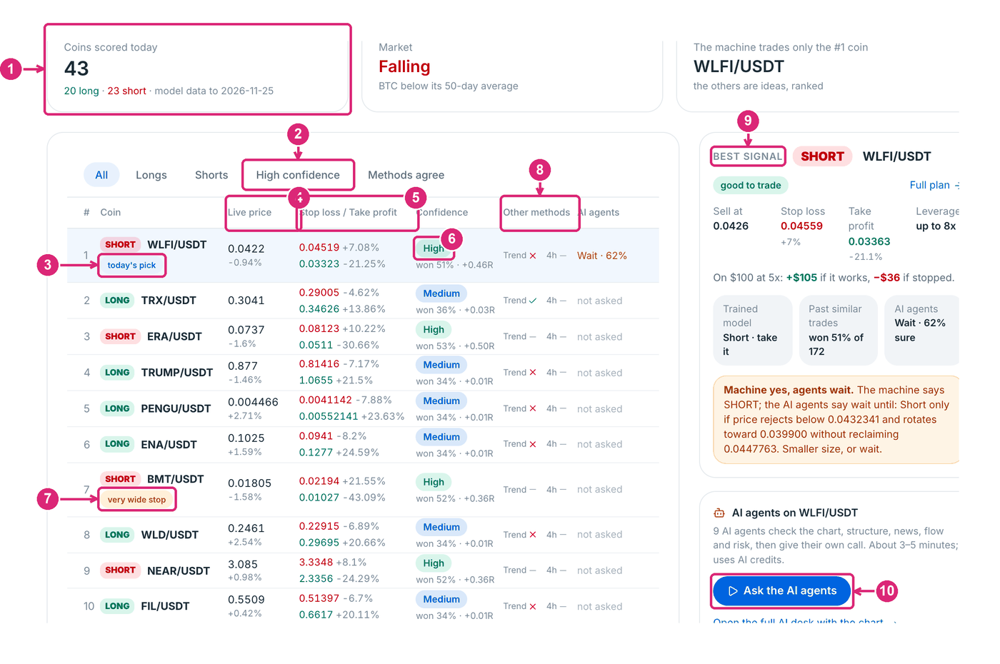

1. — **Coins scored today** (43: 20 long, 23 short), with the date of the model's data. Next to it: the market (falling) and the one coin the machine trades. · An overview. · Only #1 is the tested trade.
2. — **Filters: All · Longs · Shorts · High confidence · Methods agree.** · Show only some coins. · "High confidence" leaves out very wide stops.
3. — **today's pick.** · Rank #1: the only coin the machine trades today. · This is the main signal.
4. — **Live price** and the move since the model's daily close. · Updates every 15 seconds. · A big move since the close can mean a limit entry.
5. — **Stop loss / Take profit** with % from the live price. · Same plan style as Today's signal. · Read the % before you think about leverage.
6. — **Confidence chip (High / Medium / Low)** and "won X% · avg R". · How signals ranked like this did on 2025–26. Not a promise for this trade. · High on a short partly reflects the falling market.
7. — **very wide stop.** · The stop is more than 20% away. · Not tradeable with leverage. Skip it.
8. — **Other methods and AI agents.** · Trend and 4h: ✓ same way, ✗ other way, – no view. AI agents: their verdict from the last 24 hours, or "not asked". · Agreement is nice to see, but only the machine's #1 is tested.
9. — **Best signal** for the coin you clicked. · The same card as on the AI desk (picture 2.9). · Use "Full plan" for the leverage table.
10. — **Ask the AI agents.** · Runs the 9 agents on this coin. **It costs AI credits**, about 3–5 minutes. · Press only when you want their opinion.

## 2.17 Chart: the Signal tab

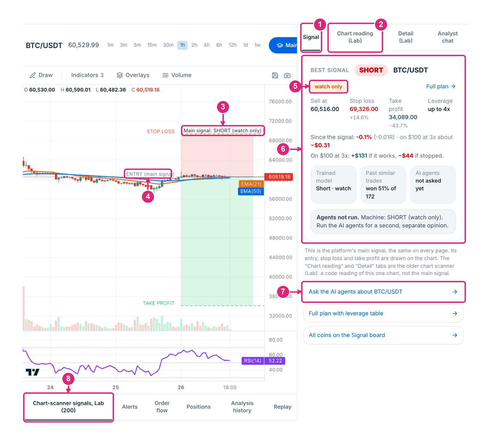

1. — **Signal tab** (the first tab). · The same Best signal card as everywhere else: the one main signal for this coin. · Start here.
2. — **Chart reading (Lab) and Detail (Lab).** · The older chart scanner: a code reading of this one chart. **Not the main signal.** · Read it as background only.
3. — **"Main signal: SHORT (watch only)" with the red and green zones.** · The main signal's stop loss (top of the red zone) and take profit (bottom of the green zone) drawn on the chart. · Check where the stop sits against recent wicks.
4. — **ENTRY (main signal).** · The main signal's entry line. · Compare it with the live price.
5. — **watch only** (or "good to trade"). · The tested rule's status for this coin today. Here BTC is not today's pick. · Trade only "good to trade".
6. — **Since the signal.** · Live profit or loss if you had entered at the signal: % move, R, and dollars on $100 at the suggested leverage. · A big move here can mean "too late" (section 4.17).
7. — **Ask the AI agents about this coin.** · Runs the agents. **It uses AI credits.** · Only when you want a second opinion.
8. — **Chart-scanner signals, Lab.** · The scanner's list of chart setups (15m, 1h, 4h…). **Not the main signal.** · Research only.

The scanner's arrows on the chart are **off** unless you tick **"show chart-scanner arrows (Lab)"** in the chart's top bar.

## 2.18 Signal history

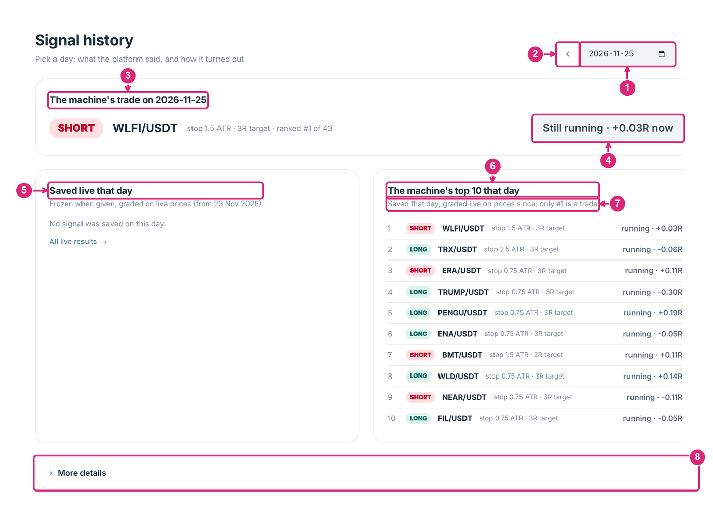

1. — **Date picker.** · Choose any day. · Look at old days to see how the platform really did.
2. — **Day before / day after arrows.** · Step one day at a time. · Quick browsing.
3. — **The machine's trade on (day).** · The #1 pick of that day: side, coin, plan, rank. · This is the only trade the machine took that day.
4. — **Its result** ("Still running · +0.03R now", or the final R). · How the trade did, after fees, in R. · Over many days, these results are the honest record.
5. — **Saved live that day.** · The signals frozen at the moment they were given and graded on live prices (from 23 Nov 2026). · The forward record.
6. — **The machine's top 10 that day.** · The ranking of that day with each coin's result. · Only #1 is a trade; the others are ideas.
7. — **Where the numbers come from** (the line under the title). · Before the last training: the machine's out-of-sample record (what it **would have said** that day, on data it never trained on). After that: the ranking saved each day, graded live. · See section 3.6.
8. — **More details.** · How to read the page. · Read it once.

## 2.19 Portfolio: add a trade your way

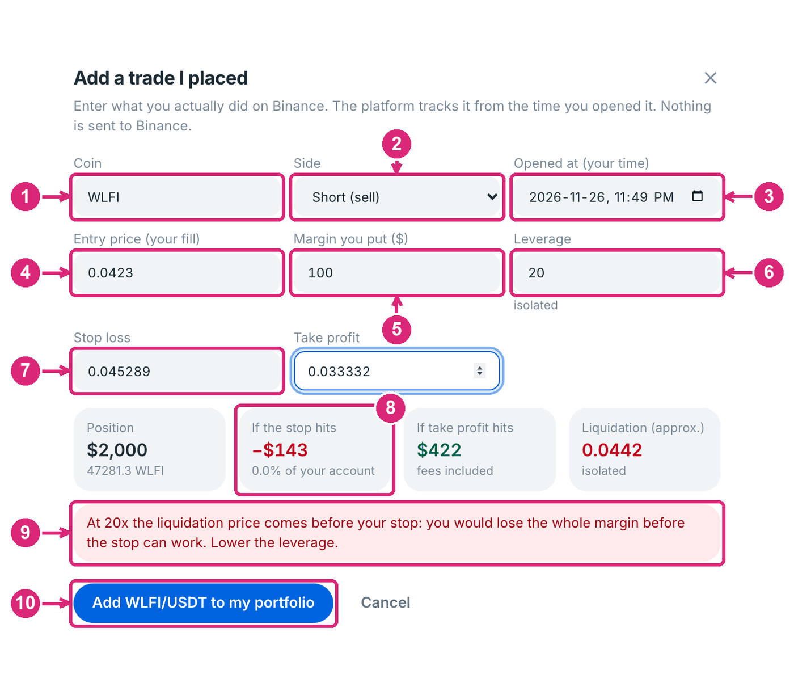

1. — **Coin.** · The coin you traded (for example WLFI). · Type it.
2. — **Side.** · Long (buy) or Short (sell). · The side you opened on Binance.
3. — **Opened at (your time).** · When you opened the trade. The platform tracks it from that moment. · Correct it if you record the trade later.
4. — **Entry price (your fill).** · The price Binance actually filled. · Copy it from Binance's Positions tab.
5. — **Margin you put ($).** · The money you put on the trade. · Copy it from Binance ("Margin").
6. — **Leverage (isolated).** · The leverage you set. · Same as on Binance.
7. — **Stop loss and Take profit.** · Your stop and target. The form checks the stop is on the right side of the entry. · Same as your TP/SL orders.
8. — **Results: position, if the stop hits, if take profit hits, liquidation.** · Calculated live as you type, fees included. · Look at the loss number first.
9. — **The warning.** · Red: "the liquidation price comes before your stop" (here at 20x: you would lose the whole margin before the stop can work). Amber: the stop would risk more than 3% of your account. · Lower the leverage or the size.
10. — **Add (coin) to my portfolio.** · Saves the trade to your record. · Press it **only** for a trade you really placed.

> In this example, the "If the stop hits" tile shows −$143. With isolated margin you cannot lose more than your $100 margin: the exchange liquidates you first. That is exactly what the red warning says.

# 3. The menu, page by page

The menu on the left has three groups and three extra links. Chapter 2 shows the screens with pictures.

| Group | Pages | Use it for |
|---|---|---|
| **Trade** | Home, Today's signal, Signal board, Signal history, Live results, AI desk | The main signal, every coin ranked, past days, and how it is doing |
| **Explore** | Markets, News, Chart, Portfolio | Looking around, news, charting, your account and trades |
| **Lab** (not the main signal) | 4h setups, Setup record, System account, Simulator | Older systems kept for research |
| More | Guide, Learn, Settings | This guide; lessons; alerts and AI usage |

There is **no login**. Everything is stored on this computer.

**Every page has the same order:**

1. A **title** and one line that says what the page is for.
2. A **main card** with the thing you came for.
3. Two or three **supporting cards**.
4. A collapsed bar called **"More details"**. Click it to open the secondary tables and explanations.

> **Tip.** If you cannot find something that this guide talks about, open "More details" at the bottom of the page. Words like R and ATR also have small tooltips: hold your mouse over them.

## 3.1 Home

**What it shows.** Home is written in plain language. Top to bottom:

1. **Today's signal** (the main card):
   - **Sell at** or **Buy at** (the entry), **Stop loss** and **Take profit**, each with its % move from the entry.
   - **Leverage: up to Nx (safe)**. This is the max safe leverage (section 4.9).
   - A **money line**, for example *"On $100 at 5x: +$106 if it works, −$36 if stopped."* (real WLFI numbers)
   - Three small chips: **Model** (its call), **Past similar trades: won %** (the simulation, section 4.14) and **AI agents** (their verdict, or "not run").
   - The **final reading** of how the three line up (section 4.13). A button opens the full plan.
2. **Live results.** A short line such as *"2 open · 0 finished · first score after 10"*.
3. **Market.** *"Market is falling"* or *"Market is rising"* (BTC below or above its 50-day average), the Bitcoin price with a small line chart, and the fear & greed number with its line.
4. **AI credits.** A small tile with the balance left. The full card is now in **Settings → AI usage** (section 8.6).
5. **Find your way.** A short map of all pages.

The signal card also has an **"All coins"** button: it opens the Signal board (section 3.3). Home refreshes itself every 30 seconds.

**"How it works, end to end"** is a strip of six steps on Home: (1) the machine scores every coin once a day; (2) read today's signal and check it is still valid; (3) get a second opinion from the AI agents only if you want (credits); (4) place it on Binance yourself, isolated, with the stop loss and take profit attached; (5) record it in Portfolio (accept the plan, or add it with your own numbers); (6) it is tracked live to the close, with results in Portfolio, Live results and History. Each step links to its page. Chapter 10 is the long version.

**How to use it.** Open Home once a day. Read the signal card and the money line. If you want to trade, open the full plan and read chapter 4 of this guide.

**What to ignore.** Do not trade from the Home card alone. It does not show the full leverage table or the risks.

## 3.2 Today's signal

This is the most important page. Chapter 4 explains it step by step.

**In short.** The main card shows the coin and side, what to do (market or limit order), and plain labels: **Buy at / Sell at**, **Stop loss**, **Take profit**, **Hold up to** (days) and **Expected result**. A chart shows these lines. Then supporting cards: the three opinions and your margin at each leverage.

Under **"More details"** you find: **"Why this trade"** (what the model saw), the **past test** (how the same plan did on unseen years), the **risky 10–20x option**, and the **top coins today**.

At the top you can type your **margin** (for example $100). All dollar numbers on the page change to match your margin. You can also type **any coin** (for example SOL) to see its plan.

## 3.3 Signal board

**What it shows.** Every coin the machine scores today (about 43), ranked, with live prices. Picture 2.16.

- Each row: **rank**, **side**, **coin**, a **"today's pick"** chip on #1 (the only coin the machine trades) or a **"very wide stop"** chip (the stop is more than 20% away: not tradeable with leverage).
- **Live price** (updates every 15 seconds and flashes green or red) with its move since the model's daily close.
- **Stop loss / Take profit** with the % from the live price.
- **Confidence: High, Medium or Low**, with "won X% · avg R" under it (see below).
- **Other methods:** Trend (the factor ranking) and 4h (the chart-setup screener): ✓ same way, ✗ the other way, – no view.
- **AI agents:** their latest verdict if they were asked in the last 24 hours, else "not asked". The agents are **not** run on the board.
- **Filters:** All, Longs, Shorts, High confidence (very wide stops left out), Methods agree.
- **The right panel** for the coin you click: the Best signal card, **"Ask the AI agents"** (about 3–5 minutes, **uses AI credits**; the board refreshes when they finish), "Open the full AI desk" and "Full plan".
- **"How accurate is each rank?"** under More details: the table by rank and side.

**What "confidence" means.** Each day every coin is ranked. The platform looked at how signals ranked like this one did on the unseen years 2025–26, by rank group (#1, #2–3, #4–10, #11+) and by side:

| Confidence | Signals ranked like this, on 2025–26 |
|---|---|
| **High** | made +0.10R a trade or more |
| **Medium** | made between 0 and +0.10R |
| **Low** | lost money |

It describes the **past of similar signals**, not the chance for this one trade. And part of it is the market: 2025–26 fell, so even low-ranked shorts made money (+0.26R a trade), while low-ranked longs lost (−0.22R). Shorts ranked #1 made +0.46R (51% won); longs ranked #1 made −0.05R (33% won). Hold your mouse over the chip to see the machine's own part: this rank minus the other coins on the same side (the market removed).

**How to use it.** Look around, compare coins, ask the agents about one coin. **Trade only #1** ("today's pick") unless you knowingly take an idea outside the tested rule.

**Refresh.** The board updates prices every 15 seconds; Home, Today's signal, the Best signal card and Live results every 30 seconds; Signal history every 60 seconds. The machine itself re-scores only once a day, after the daily candle closes.

## 3.4 Live results

**What it shows.** Every main signal is saved the moment it is given. Then it is graded on live Binance prices. This is the honest, real-time score. Chapter 7 explains it.

The page has: a **score card with 3 tiles** (finished signals, share that made money, average R), the list of **every signal**, and **Add a coin**. Under "More details": the results by group, the machine vs AI agents split, the agents' own record, and the **"Agents as a veto"** status (section 7.5).

**How to use it.** Check it once a week. Wait for at least 10 finished signals before you believe any number. Wait for 50 or more before you trust it.

**What to ignore.** A good or bad week. Small samples jump around a lot (see section 7.3).

## 3.5 Signal history

**What it shows.** Pick any day (date picker, or the arrows for the day before and after). You see: **the machine's trade** that day (the #1 pick) with its result, **the top 10** of that day with their results, and **the signals saved live** that day. Picture 2.18.

**Two sources, kept apart:**

- **Up to the last training:** the machine's **out-of-sample record**. Each day was predicted by models that never saw it. It shows what the machine **would have said** that day, not a message that was sent.
- **After that:** the **ranking saved each day**, then graded live on real prices.

"Running" means neither the stop nor the take profit has been hit yet (up to 14 days); the R shown is where it stands now. A day's signals are made from that day's closing prices and given just after midnight UTC.

**How to use it.** Look at many days, not one. A good or bad week tells you little (chapter 7.3).

## 3.6 AI desk

**What it shows.** A team of 9 AI "leads" (and 23 helpers) who study one coin like a trading desk. They research, analyse, argue, make a plan, get checked by code, and then the Head Trader says LONG, SHORT or WAIT. Chapter 8 explains them.

**How to use it.** Pick a coin from the shortlist on the left (chosen by code, free) or search any coin. Enter your budget. Press the button to run. It takes about 3–5 minutes and uses AI credits.

**The "Best signal" card.** As soon as you pick a coin, the desk shows a **Best signal** card for it. It puts together, in one place:

- the trained model's plan for that coin (side, entry, stop, take profit),
- the money line (what you win or lose on your margin),
- "past similar trades" (the model's past picks, won %),
- the AI agents' latest verdict on that coin (if any),
- and one plain reading of how they line up.

It shows **before** a run (free) and is updated **after** a run. For a thin coin that the trained model does not cover, the card says so, and the AI agents are the only opinion.

**After a run,** the **Plan** tab shows the Best signal first, then **"The AI agents' own plan"** (Sentinel's stop, target, leverage and size). The trained-model forecasts and the chart-pattern cards are under **"Details"**.

**What to ignore.** The moving "cursors" of the agents. They are only a show of the work. Read the Best signal and the final decision.

> The trained-model plan and forecasts on the desk are free. They run on the platform itself and need no AI key. Only the agents cost credits.

## 3.7 Markets

**What it shows.** A table of the liquid coins (coins with enough trading). Columns:

| Column | Meaning |
|---|---|
| Price, 24h, 7d, 28d | Last price and the % change over 1 day, 7 days and 28 days |
| Trend score (0–100) | The coin's average rank among these coins on 8 trend signals (momentum, moving averages, volume). 100 = strongest trend |
| Up next week | How often coins with a similar score actually went up the next week, in the past |
| Funding / yr | The funding rate of the perpetual, shown as % per year. Above +30% or below −30% means the crowd is leaning hard one way |
| Market cap | Price × coins in circulation |

The filter buttons: All, Strong trend (score 80+), Weakest (20 or less), Crowded longs (funding above +30%/yr), Crowded shorts (below −30%/yr).

**How to use it.** Look for context. Click a coin to open it on the AI desk.

**What to ignore.** "Up next week" near 50% means almost no edge. It is a past frequency, not a promise.

**Why funding is shown per year.** Funding is paid every 8 hours and is a tiny number (like 0.01%). Shown per year it is easier to compare. 0.01% every 8 hours is about 11% a year.

## 3.8 News

**What it shows.** Crypto headlines in plain words. At the top: **Market mood** (fear & greed 0–100 and how many headlines are positive or negative) and **Big news now** (the top 3 high-impact headlines). Below: **All headlines**, with filters (All, Big news, Positive, Negative, and today's signal coin) and a coin search. Each headline has an **impact** chip (Big news / Worth knowing / Minor), a **type** (Hack, Regulation, ETF…), a **mood** word and its coins. "How the news is read" is under More details. Picture 2.13.

**How to use it.** Before a trade, press the filter with today's signal coin. Look for Big news (a hack, a delisting, a regulation story).

**What to ignore.** News **never triggers a trade**. A positive headline is not a reason to buy.

## 3.9 Chart

**What it shows.** A full charting terminal (like TradingView): candlesticks, 41 indicators, drawing tools (lines, rays, zones, Fibonacci, long/short box) and volume profile. Picture 2.17.

The right side has tabs:

- **Signal** (the first tab): the same Best signal card as everywhere. The main signal's **entry, stop loss and take profit are drawn on the chart**.
- **Chart reading (Lab)** and **Detail (Lab):** the older **chart scanner**, a code reading of this one chart.
- **Analyst chat.**

The chart scanner's arrows are **off** unless you tick "show chart-scanner arrows (Lab)". Its list at the bottom is "Chart-scanner signals, Lab".

**Why the chart scanner can say LONG while the main signal says SHORT (or "no clear side").** They are **two different systems**. The chart scanner reads the shape of one chart on one timeframe (for example a pullback on the 15-minute chart). The main signal is one trained model that compares every coin's daily data with every other coin, and it was tested on years it never saw. They often disagree, and that is normal. **Only the main signal is tested.** When they disagree, follow the main signal, or don't trade.

**How to use it.** Look at the coin before you trade. Check where the main signal's stop sits against recent wicks.

Section 5.6 explains how to read the chart.

## 3.10 Portfolio

**What it shows.** Your account and today's plan for it. Pictures 2.14 and 2.15.

1. **Set up your account** (first time): type your Binance futures balance in USDT once. Change it later with the pencil.
2. **Your account:** account value now, profit or loss since you started, open trades, margin in use, "lose if all stops hit", and how far you are below your best value (the peak).
3. **Risk manager:** code (not you, not an AI) picks the risk mode from the evidence and lists its reasons in plain words (section 9.5 explains the rules).
4. **Today's plan:** today's main signal sized for your account: side and coin, Buy/Sell at, Stop loss, Take profit, Leverage (isolated) with the liquidation price, **Put in (margin)**, **If the stop hits** (−$) and **If take profit hits** (+$). Buttons: **"Accept as suggested"** (you placed exactly this), **"Accept with my numbers"** (you placed it with a different fill, margin or leverage) and **"Skip today"**.
5. **Open trades** (tracked every day) with two buttons: **"+ Add a trade"** (a simple form for any trade you placed: coin, side, entry fill, margin, leverage, stop, take profit and the time you opened it; it shows the position size, loss at the stop, gain at the take profit and liquidation, and warns you when the liquidation comes before the stop or more than 3% of the account is at risk) and **"Let the AI plan one"** (the AI form; it uses AI credits). Then **Closed trades** (with the win rate and the total).
6. Under **More details:** the AI portfolio desk (runs only when you press "Ask the AI desk"; it uses AI credits), the budget plan and the paper account.

**How to use it.** Chapter 10 explains the whole flow: read the signal → place it on Binance → accept it (as suggested or with your numbers) → manage it.

> Leverage only changes how much margin you lock. It never changes the loss at the stop, and it never makes a prediction more accurate.

## 3.11 The Lab pages (not the main signal)

| Page | What it is | Should I trade from it? |
|---|---|---|
| **4h setups** | A code screener. It picks up to 5 chart setups a day on the 4-hour chart (pullbacks, breakouts, sweeps). Each row now shows the **main signal** for that coin: "SHORT ✓ agrees", "✗ disagrees" or "no clear side". On a conflict the button says **"Main signal disagrees — skip"** instead of "Take now". | No. Research only. If you look, skip every setup the main signal disagrees with. |
| **Setup record** | How every 4h setup did, paper-traded, with a $10,000 paper equity curve. Losses included. | No. It is the record of the Lab system. |
| **System account** | A simple rule-based daily trend system with its own $100 paper account. It buys a daily close above the 20-day high while BTC is above its 200-day average. Stop 2.5 ATR, a third sold at 2R, the rest trails 3 ATR below. | Only if you understand it. It is not the main signal. |
| **Simulator** | Replays a factor ranking (momentum, trend, funding) on any of 591 coins. Has a "test against luck", a Monte Carlo of the next year, a funding-carry tab and a "vs competitors" tab. | No. It is a research tool. |

**Why keep the Lab?** To compare. If the main signal stops working, the Lab shows if other ideas do better. It also shows what does *not* work, which is useful too.

## 3.12 Guide, Learn and Settings

**Guide.** This guide inside the app, with a link to download the PDF.

**Learn.** Lessons in 5 parts: using the platform; trading basics; price action and Smart Money Concepts; futures data, news and sentiment; risk, planning and psychology. Good lessons for you: "Spot vs futures, leverage & liquidation", "Why a 95% win rate is a trap", and "Risk management".

**Settings.** The guide, browser alerts, "Your account" (no login needed: everything is stored on this computer; your balance lives on Portfolio), and **AI usage**: the full AI credits card (balance left, spend per day, per feature and per run; section 8.6). Exchange trading keys are never requested. Live order sending is not built.

# 4. Reading Today's signal, step by step

We follow the page from top to bottom. We use the real signal of 26 November 2026 (WLFI short) and the made-up $100 coin.

> **Where things are on the screen.** The main card has the call, what to do, the levels and the chart. Then come the three opinions and the leverage table. "Why this trade" (4.12), the past test (4.16), the risky 10–20x option (4.11) and the top coins (4.16) are under **"More details"** at the bottom. R and ATR are explained in tooltips on the page.

## 4.1 The top line: the date and the market

You see something like: **"Data to 2026-11-25"** and a chip **"Market DOWN"**.

- **Data to (date).** The model uses *daily* candles. A daily candle on Binance closes at 00:00 UTC. The model only uses finished days. So on 26 November it uses data up to 25 November. This is normal. (See the FAQ, chapter 12.)
- **Market UP / DOWN.** Is Bitcoin above or below its 50-day average price? On 25 November BTC closed at $60,458. Its 50-day average was $75,236. So the market is DOWN. In the 2025–26 tests, longs did badly when BTC was below its 50-day average.

## 4.2 The call: side, coin, price

A big **LONG** (green) or **SHORT** (red), the coin (for example WLFI/USDT), and a line like:

*"Price 0.0420 · 24h +2.4% · daily move 4.7% · #1 of 43 for a short"*

- **Daily move 4.7%** is the **ATR** in percent (see 4.8). It means this coin moves about 4.7% in a normal day.
- **#1 of 43** means the model ranked this coin first out of 43 liquid coins today.

On the right you see a badge and the expected result:

| Badge | Meaning |
|---|---|
| **Tested edge** | On the unseen years, the engine averaged at least +0.05R a trade and beat a random coin with the same plan |
| **Weak edge** | Positive on the unseen years, but small or not better than random |
| **No tested edge** | Lost money on the unseen years |

**"Expected +1.24R a trade"** (the label "Expected result") is the model's own forecast for this one trade.

> **Be careful with "expected R".** It is a *ranking number*, not a promise. The model gives every coin a forecast, and picks the coin whose forecast stands out most against the other coins that day. A high forecast on its own is not a signal: when the team checked all days where the short forecast was 1.24R or higher on any coin, those trades averaged **−0.15R**. The real average of the engine's picks was **+0.08R**. Trust the tested record, not the forecast.

## 4.3 TRADE or WATCH ONLY

- **TRADE** (green box): the tested rule takes this trade today.
- **WATCH ONLY** (amber box): the rule would not take it. The box lists the reasons ("gates"). Examples:
  - "Not among today's top 1 picks" (you opened another coin).
  - "Extreme volatility": the coin's daily move (ATR) is above 25% after a pump or crash. Stops based on ATR are meaningless then.
  - "The best plan for this coin is expected to lose money".
- **No trade today**: no coin passes. The page shows the best idea for your watch list. Waiting is also a position.

## 4.4 "What to do": market or limit entry

The blue box tells you the order in one sentence. Two kinds of entry:

- **Market entry** ("Sell at about 0.0420"). You enter now at the current price. This is the WLFI case on 26 Nov: the price had moved about 0.3 ATR down since the model's data, less than 0.33 ATR, so it is still fine to take at market.
- **Limit entry** ("Place a sell LIMIT order at ... — don't use market"). This appears only when the price already moved **more than one third of a daily move (0.33 ATR)** in the trade's direction since the model's data. The platform does not want you to chase. The limit sits 0.33 ATR from yesterday's close. That is on the right side of the current price: it waits for a pull-back. If the price moved less than that, it is a market entry.

**Why a limit?** The model judged the coin at yesterday's close. If the price already ran, your stop is now further away and your target closer. The trade is worse. A limit gets you a price closer to what the model saw.

**When to cancel:** if the price reaches the stop before your order fills, or if the order is not filled within 2 days. The model makes a new pick every day.

> **Fixed on 26 Nov 2026.** Before this date the switch was at 0.25 ATR, so a "limit" could sit on the wrong side of the price and fill at once. Now a buy limit is always below the price and a sell limit always above it.

The box also says the leverage to use, for example **"Leverage 2x–5x, isolated."** The page keeps this suggestion at 5x or lower even when more is "safe".

## 4.5 The levels: entry, stop, target, hold

Four tiles:

| Tile | Real example (WLFI short) | Meaning |
|---|---|---|
| Sell at (entry) | 0.0420, market | Where you open the trade |
| Stop loss | 0.044989 (+7.1%) | If price goes UP here, you are wrong. Close the trade. |
| Take profit (target) | 0.033032 (−21.4%) | If price goes DOWN here, take the profit |
| Hold up to | 14 days | If neither is hit in 14 days, close the trade |

For a **short**, the stop is *above* the entry and the target is *below*. For a **long**, it is the opposite.

**One target, no partial close.** The main plan closes the whole trade at the target. It does not close half early. The plan was tested exactly like this. If you move the stop or take profit early, you change the odds, and the test no longer applies.

## 4.6 The plan chart

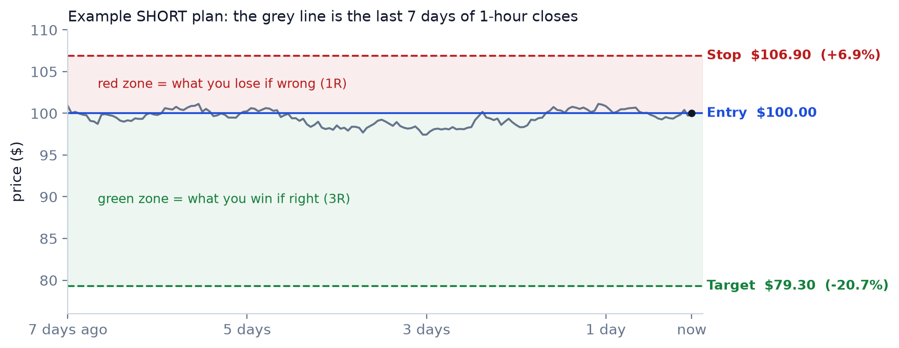

- **Grey line:** the closing price of every hour for the last 7 days (168 hours).
- **Blue line:** entry. **Red dashed line:** stop. **Green dashed line:** target.
- **Light red area:** the distance from entry to stop. This is your risk, 1R.
- **Light green area:** the distance from entry to target. This is your reward.
- **Dot at the right end:** the price now.

**Why it looks like this.** The target is far away compared to the stop. That is on purpose: the target is usually 3 times the stop (3R). The model accepts losing more often in exchange for bigger wins.

**How to use it.** Look at where the grey line has been. If the stop is very close to where the price jumped many times in the last days, a normal wiggle could hit it.

## 4.7 R and 3R (the most important idea)

**R** is the amount you lose if the stop is hit. It is your "risk unit".

- If the stop hits, you lose **1R**.
- If the target is 3 times as far as the stop, a win is **+3R**.
- If you lose $35 at the stop, then 1R = $35, and 3R = $105.

**Example ($100 coin, short):** entry $100, stop $106.90. The stop is $6.90 away (6.9%). With $100 margin at 5x, your position is $500. The loss at the stop is $500 × 6.9% = $34.50, plus about $0.50 fees = **$35 = 1R**. The target $79.30 is $20.70 away = 3 × $6.90. A win is about $103.50 − $0.50 = **$103 ≈ 3R**.

**Why the platform counts in R and not in %.** R lets you compare trades with different stops and different leverage. +0.08R means "on average, each trade made 8% of what you risk". If you risk $35, that is about $2.80 a trade, on average, over many trades.

**Why the plan is called "1.5ATR_3R".** Stop = 1.5 ATR away. Target = 3R = 3 × 1.5 ATR = 4.5 ATR away. Other plans have stops of 0.75 or 2.5 ATR and targets of 1.5R or 2R.

## 4.8 ATR (the daily move)

**ATR** (Average True Range) is how much the coin normally moves in one day, on average over the last 14 days. The page shows it in % as "daily move".

**Why the platform uses it.** A 5% stop is very tight for a wild coin, but very wide for Bitcoin. ATR fixes this: stops and targets are measured in "daily moves" of *that* coin. A 1.5 ATR stop is one and a half normal days of movement.

**Example:** WLFI ATR = 4.68%. Stop 1.5 ATR = 1.5 × 4.68% ≈ 7.0% (the page shows 7.1% because of rounding and the entry price). Target 4.5 ATR ≈ 21%.

**Volatility cap.** If a coin's ATR is above 25% (it moves a quarter of its price per day, after a pump or crash), it is never picked.

## 4.9 Max safe leverage

The page shows **"Max safe leverage 8x"** (never more than 20x on the screen).

**What it means.** The highest leverage where the **liquidation price** stays well behind your **stop**. "Well behind" means: the distance to liquidation is at least **1.5 times** the distance to the stop.

**Why 1.5 times?** Wicks (fast spikes), the mark price, and fees. Binance uses a "mark price" for liquidation. It can be a bit different from the last price. The buffer makes sure your stop closes the trade, not the exchange.

**How it is calculated (simple version):**

> max safe leverage = 1 ÷ (stop% × 1.5 + maintenance margin)
>
> Maintenance margin: BTC 0.4%, ETH 0.5%, other coins 1%.

**Example:** stop 7.1% on an altcoin: 1 ÷ (0.071 × 1.5 + 0.01) = 1 ÷ 0.1165 = 8.6 → **8x**.

## 4.10 The leverage table and liquidation

The card "Your $100 margin at each leverage" shows one row per leverage. Real WLFI numbers with $100 margin, stop 7.1%:

| Leverage | Position | Liquidation | If stop hits | If target hits | Label |
|---|---|---|---|---|---|
| 1x | $100 | 0.0836 | −$7.22 | +$21.25 | |
| 2x | $200 | 0.0626 | −$14.43 | +$42.50 | |
| 3x | $300 | 0.0556 | −$21.65 | +$63.76 | |
| 5x | $500 | 0.0500 | −$36.09 | +$106.26 | **max safe** (shown) |
| 10x | $1,000 | 0.0458 | −$72.17 | +$212.52 | **tight** |
| 15x | $1,500 | 0.0444 | −$100 (all) | — | **liquidated before stop** |
| 20x | $2,000 | 0.0437 | −$100 (all) | — | **liquidated before stop** |

(Max safe here is 8x, which is not a row in this table, so the "max safe" chip sits on 5x, the highest safe row shown.)

**How to read each column:**

- **Position** = margin × leverage. This is the real size of your trade.
- **Liquidation** = the price where Binance closes your trade and you lose your whole margin.
- **If stop hits** = position × stop% + fees. A negative number.
- **If target hits** = position × target% − fees.

**The three labels:**

- **max safe** (green): the highest row that passes the 1.5× buffer rule.
- **tight** (amber): liquidation is still after the stop, but close. A wick could liquidate you.
- **liquidated before stop** (red): the liquidation price comes *before* your stop. The exchange closes you first. You lose the **whole margin**, not just 1R. Never use these.

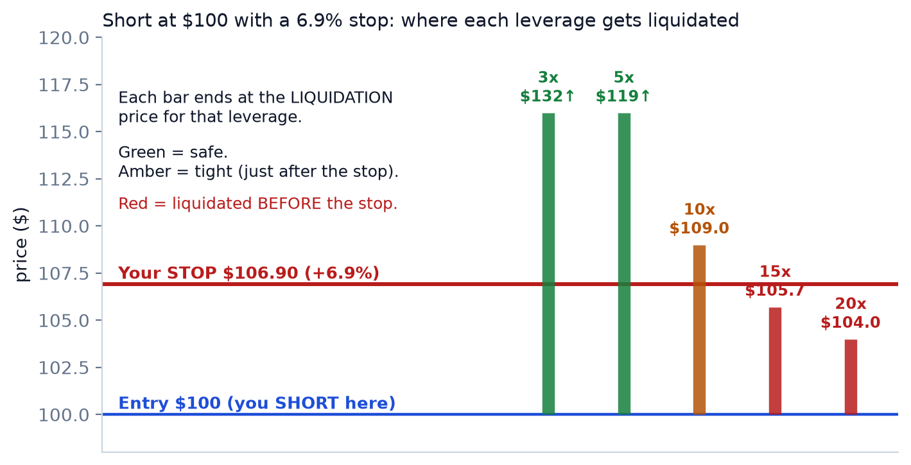

**Why 20x is liquidated here.** At 20x, the price only needs to move about 4% against you (5% minus 1% maintenance margin) to liquidate an altcoin position. This stop is 7.1% away. So the price hits liquidation first.

## 4.11 The risky option: 10x–20x tight stop

At the bottom of the page there is a red card: **"Risky option · 10x–20x tight stop"**.

**What it is.** The same side on the same coin, but with a much closer stop: **0.75 ATR**. The target is usually 3R.

**Real example (WLFI):** stop 3.6% away, target −10.7%. Max safe leverage 15x. 20x is "tight". Expected +0.50R (lower than the main plan's +1.24R).

| Leverage | Position | If stop hits | If target hits | Label |
|---|---|---|---|---|
| 5x | $500 | −$18.29 | +$52.88 | |
| 10x | $1,000 | −$36.59 | +$105.76 | |
| 15x | $1,500 | −$54.88 | +$158.64 | max safe |
| 20x | $2,000 | −$73.17 | +$211.52 | tight |

**Why it is risky:**

1. **The stop is smaller than one normal day.** WLFI moves 4.7% a day. The stop is 3.6% away. A normal day can hit it without any real reason.
2. **More trades end at the stop.** On 2025–26, trades with a 0.75 ATR stop won only 34% of the time (1.5 ATR stops: 38%; 2.5 ATR stops: 46%).
3. **Wicks and mark price.** A fast spike of a few seconds can take your stop or even your liquidation.
4. **Losing streaks feel bigger.** At 20x every loss is large in dollars. See section 9.7.

**Why it exists at all.** Because you asked for a high-leverage option. It shows you the *honest* way to use 10–20x: with a stop that is close enough that liquidation is still behind it.

## 4.12 "Why — what the model saw"

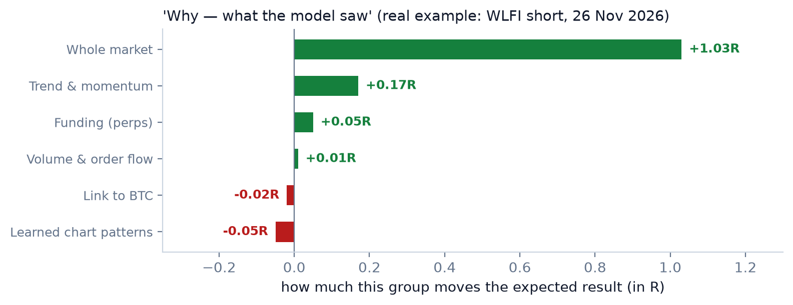

**What it is.** The model looks at about 100 inputs. Each input pushes the forecast up or down. This card adds them up by group. Each bar shows how much a group moves the expected result, in R.

- **Green bar:** this group helps the trade.
- **Red bar:** this group works against the trade.
- **Longer bar:** bigger effect.
- Under each group you see the top inputs with their values.

**Real example (WLFI short):** "Whole market +1.03R". The inputs: BTC's 30-day volatility, BTC 16% below its 200-day average, BTC down 26% in 28 days. In words: *"the whole market is weak, and in a weak market this kind of coin tends to fall"*. "Trend & momentum +0.17R": WLFI is down 28% in 90 days. "Learned chart patterns −0.05R": similar past charts slightly disagree.

**Why it looks like this.** The method is called **SHAP** (see glossary). It splits one forecast into the share of each input. The bars add up to the difference between this forecast and the model's average forecast.

**How to use it.** Ask: "Do I believe these reasons?" If the whole reason is "the market is weak", the trade depends on the market staying weak.

**Groups you may see:** Whole market; Trend & momentum; Oscillators & reversal; Volatility; Volume & order flow; Funding (perps); Link to BTC; Learned chart patterns. (Groups like Market structure, Liquidity, Wyckoff are only shown if the concept inputs are switched on. They are off now; see 6.6.)

## 4.13 Three separate opinions, and the final reading

The card **"Three separate opinions"** shows three columns. Each one decides on its own.

| # | Opinion | What it is | Costs AI credits? |
|---|---|---|---|
| 1 | **Machine model** | The engine's call: side, trade or watch, plan, expected R, its unseen-years record, top 3 reasons | No |
| 2 | **Simulation** | What the machine's *own past picks* like this one did, and a Monte Carlo of the next 20 trades | No |
| 3 | **AI agents** | The AI team's separate analysis: LONG, SHORT or WAIT, confidence, conditions, the Head Trader's reasoning | Yes, only when you press "Run AI agents" |

Above the columns is **one plain reading** of how they line up:

| Reading | When | What it suggests |
|---|---|---|
| **Both say SHORT** (green) | The agents say the same side as the machine | The strongest case the page can show |
| **Machine yes, agents wait** (amber) | The agents say WAIT | Smaller size, or wait for the agents' condition |
| **They disagree** (red) | The agents say the opposite side | Conflicting signals: skip this one |
| **Agents not run** (grey) | No fresh agent verdict | Run the agents if you want a second opinion |

**Real example (26 Nov 2026):** the machine says SHORT (trade). The agents say **WAIT** (confidence 62%): *"Short only if price rejects below 0.0432 and moves toward 0.0399 without going back above 0.0448."* So the reading is **"Machine yes, agents wait"**.

> **This reading is not a new model, and it is not backtested.** It is only a summary. The Live results page scores each case (agreed, wait, disagreed, not asked) from now on, so after enough trades you will see if listening to the agents helps.

An agent verdict counts only for **24 hours**. After that it shows "old, run again".

## 4.14 The simulation column, line by line

The top part shows the machine's **past picks** on the unseen years 2025–26. Each line: average R a trade · share that made money · number of trades.

| Line | Meaning | Real example (WLFI short) |
|---|---|---|
| All its shorts | Every short the engine took in 2025–26 | +0.46R · 51% won · 172 |
| This exact plan | Only trades with the same plan (short, 1.5 ATR, 3R) | +0.44R · 61% won · 49 |
| On this coin | The engine's trades on this coin | +0.76R · 76% won · 21 |
| All its trades | Every trade, long and short | +0.08R · 38% won · 678 |
| This plan, any day, no model | This plan on this coin on *every* day, without the model choosing | +0.42R · 61% · 292 days |

**How to read it.** Small counts (like 21 trades on one coin) are not reliable. Give more weight to the big lines. "All its trades" (+0.08R) is the most honest single number.

The last line is a **base rate**: what the plan does on this coin without any model. If the model's lines are not better than this, the model adds little on this coin.

## 4.15 The Monte Carlo table: middle, bad–good range, ends down

The bottom part: **"Next 20 trades like this · $100 margin each · 10,000 runs"**.

**What Monte Carlo means here.** The computer takes the engine's real past results (here: its 172 shorts from 2025–26). It draws 20 of them at random, like pulling 20 cards from a deck (each card goes back after drawing). It adds up the dollars. It does this 10,000 times. Then it shows what usually happens.

Real example (WLFI, stop 7.1%, $100 margin):

| Leverage | Middle | Bad · good (90%) | Ends down |
|---|---|---|---|
| 1x | +$64 | −$16 · +$149 | 10% |
| 3x | +$192 | −$49 · +$446 | 10% |
| 5x | +$319 | −$82 · +$743 | 10% |
| 10x | +$639 | −$165 · +$1,485 | 10% |
| 20x | liquidated before the stop · not possible | | |

- **Middle** = the median. Half of the 10,000 runs ended above it, half below.
- **Bad · good (90%)** = 5% of runs ended below the bad number; 5% ended above the good number. 90% landed in between.
- **Ends down** = the share of runs where the 20 trades lost money in total.

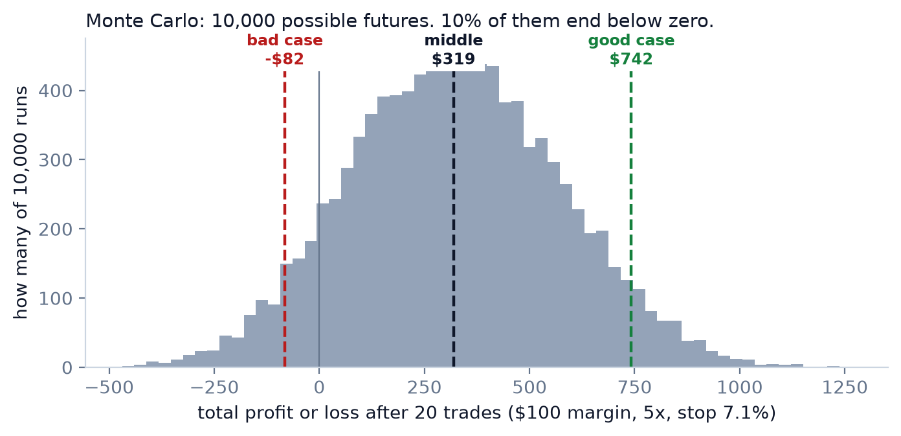

**Why "ends down" is the same at every leverage.** Leverage multiplies every trade's dollars by the same number. A run that lost money at 1x also lost money at 10x, just more of it. So the chance of ending down does not change. Only the size of the loss or gain changes.

**Why 20x shows "not possible".** At 20x on an altcoin, liquidation is about 4.5% away. The stop is 7.1% away. So the trade would be liquidated before the stop. The past record only has daily candles, so it cannot know how many of the *winning* trades were liquidated on the way. No honest number exists, so none is shown.

> **Be careful.** This sample uses only the engine's shorts, which did very well in 2025–26 (+0.46R). All trades together did +0.08R. If shorts become average, the real results will be much lower than the "middle" here. The page says it too: *not a promise, the past can change.*

## 4.16 Risks, unseen-years record, top coins

(The past test, the risky option and the top coins are under "More details" on the page.)

**Risks · when not to trade.** Always read this card. It holds:

- When to cancel (stop reached before fill, or no fill in 2 days).
- A reminder that picks made money only 38% of the time.
- "One target, no partial close."
- If you look at a long while BTC is below its 50-day average: "longs went against the market in 2025–26 tests."
- No signal reaches 90%. Paper first.

**How this plan did on unseen years.** Four tiles:

| Tile | Value | Compared with |
|---|---|---|
| Trades tested | 678 | 2025–26, never seen |
| Made money | 38% | random coin 38% |
| Average result | +0.08R | random coin −0.06R |
| Total | +54R | over all trades |

> **Look at this closely.** The engine and a random coin *win the same share of trades* (38%). The difference is the *size*: the engine's winners are bigger and its average is positive. This is why the platform talks about R, not win rate.

Below: the 90% range (−0.06R to +0.23R), and "How it was tested" with the result for each year.

**Top coins today.** Two short lists, LONG and SHORT: each coin's best plan and its expected R. Click one to see its full plan. Only the #1 coin overall is the signal. The others are WATCH ONLY.

**Any coin.** Type a coin in the search box. You get the same plan for it. The main engine covers coins that trade about $5M or more a day and have 90+ days of history. For thinner coins ($1–5M a day) the page falls back to an older, simpler plan with a two-step target (TP1, close half; TP2) and the three opinions are not shown. Below about $1M a day it says "Not covered". You can press "+ Add to signal test" to have any plan graded on live prices.

## 4.17 Is it still valid? Live checks, "Not tradeable now" and "no clear side"

The machine makes its signal **once a day**, from the daily close. The price keeps moving all day. So every signal is checked against the **1-hour candles since it was given**:

| Check | What it means | What to do |
|---|---|---|
| **stop already hit** | The price touched the stop after the signal. The trade already failed. | Skip it. |
| **target already hit** | The price touched the take profit. It already worked. | Too late. Don't chase. |
| **moved away · too late** | The price already went **half the way or more** to the target. Entering now is a worse trade: your stop is far, your target is close. | Skip it, or wait for the next signal. |
| (no chip) | Neither level touched and the price is still near the entry. | The signal is valid. |

(A candle touching both the stop and the target counts as the stop, as in the backtest.)

When a check fails, the page shows **"Not tradeable now"** with the reason, and the page will not say TRADE, "Take now" or Accept: Today's signal, Home, the Signal board, the Best signal card, Portfolio's Today's plan and the 4h setups all follow this. **Why can't you accept it?** Because the trade that was tested is already over, or it is no longer the same trade. Accepting it would record a trade the test never covered.

**"Since signal"** (on the board, the Best signal card, Home and Today's signal) shows the live profit or loss as if you had entered at the signal: % move, R, and dollars on $100 at the suggested leverage. It is for information; it is not your trade.

**"No clear side."** Some coins show **NO CLEAR SIDE** instead of LONG or SHORT. This happens when the model's own forecast for the coin's best-ranked plan is **negative** (and the coin is not the #1 pick). On such coins the past cannot say which side is right: the side the model **ranked** made money in 2021–24 (+0.04R) and lost in 2025–26 (−0.13R), while the side with the **best forecast** did the opposite (−0.05R, then +0.12R). They swapped which one won. So the platform does not claim a direction for these coins. Don't trade them.

**How often pages refresh:** the Signal board every 15 seconds; Home, Today's signal, the Best signal card and Live results every 30 seconds; Signal history every 60 seconds. Live results grade the signals every minute. The machine itself still re-scores once a day.

# 5. Every chart, explained

This chapter explains each kind of chart on the platform: what the axes and colours mean, and why it looks like that.

**Colour rules used everywhere:**

| Colour | Means |
|---|---|
| Green | Up, long, profit, "helps the trade", safe |
| Red | Down, short, loss, "against the trade", danger |
| Amber / orange | Careful: tight, wait, watch only |
| Blue | Neutral information: entry line, the main line of a chart |
| Grey | Background, no data, "not used" |

## 5.1 The plan chart (Today's signal)

See section 4.6. Grey line = hourly closes for 7 days. Blue = entry, red dashed = stop, green dashed = target. Red area = risk (1R), green area = reward.

**Why the target looks far away:** the target is usually 3R, so the green area is 3 times taller than the red area.

**Why the line sometimes looks flat:** the chart zooms so that the entry, stop, target *and* the price all fit. When the target is far away, the last 7 days of price look small.

## 5.2 Sparklines (the small lines on Home and in tables)

A **sparkline** is a tiny chart with no axes. It only shows the shape.

- **Bitcoin sparkline (Home, Market card):** the BTC price over recent months. A faint filled area under one line. Move your mouse over it to see the value on a day.
- **Row sparklines (in tables):** a tiny price line for one coin. Green when the window ends higher than it started, red when lower.

**Why no axes?** It is only for the direction at a glance: up, down or sideways. For real numbers, use the Chart page.

## 5.3 Fear & greed (number and line)

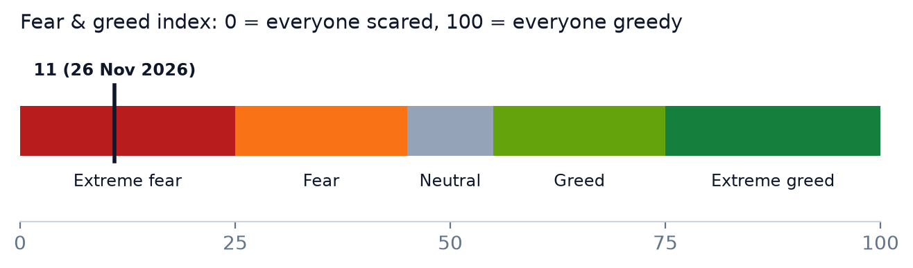

**What it is.** A public index from 0 to 100 (from alternative.me) that tries to measure the mood of the crypto market. It mixes price moves, volatility, volume, social media and Bitcoin dominance.

- 0–25: Extreme fear. 25–45: Fear. 45–55: Neutral. 55–75: Greed. 75–100: Extreme greed.
- On Home you see the number (for example "11 Extreme Fear") and a small line over time with a **neutral 50 line** across the middle.

**Why the platform shows it.** It is context. Extreme fear often comes after big falls; extreme greed after big rises. It is *not* a buy or sell signal on its own. The AI agents read it; the machine model uses other market numbers instead.

## 5.4 AI spend per day (bars in Settings → AI usage)

- One bar per day for the last 14 days. The right end is today.
- **Taller bar = more dollars spent on AI that day.** The tallest day fills the box; others are scaled to it.
- A tiny grey bar = no AI spend that day.
- Move your mouse over a bar to see the date, the dollars and the number of AI calls.

**Why some days are empty.** Since version 0.44 the AI only runs when you press a button. Days where you did not run the agents cost nothing.

## 5.5 The "why" bars (contributions)

See section 4.12. Each bar is a group of inputs. Green helps the trade; red works against it. The length is the effect in R. Small groups (less than 0.005R) are hidden.

**Why one group can be very big.** In a strong market move, the "Whole market" group often dominates. The model has learned that in a falling market, shorts on weaker coins pay more. It is a real pattern in the data, but it also means the trade depends heavily on the market.

## 5.6 The candlestick chart (Chart page)

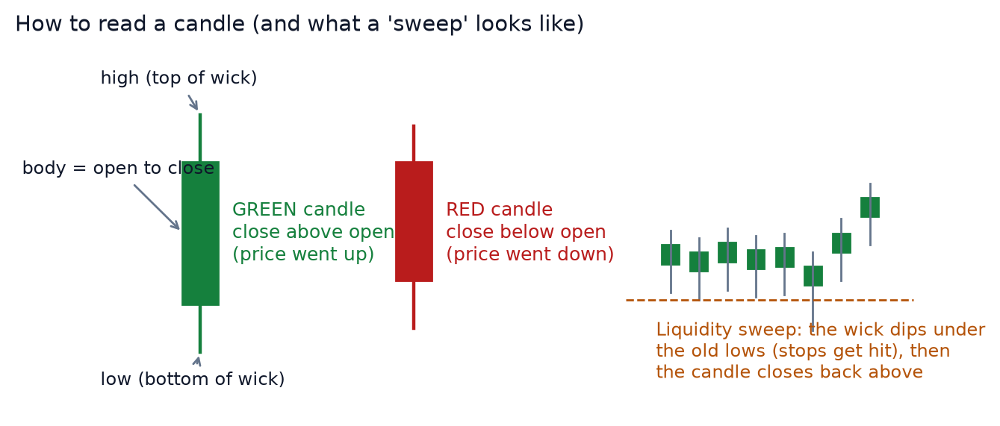

**Candles.** Each candle is one period (15 minutes, 1 hour, 4 hours or 1 day, as you choose).

- **Body:** from the open price to the close price.
- **Green candle:** the close is higher than the open (price went up in that period).
- **Red candle:** the close is lower than the open (price went down).
- **Wicks** (thin lines): the highest and lowest prices in that period.

**Axes.** Time goes left to right. Price is on the right side. Volume (how much was traded) is in bars at the bottom.

**The boxes, zones and dashed lines on the chart:**

- A purple **entry zone**, a red dashed **SL** (stop loss) line and green dashed **TP** (take profit) lines. These come from the **pattern scanner** (Lab), not the main signal.
- **Drawings** from the Guided analysis: swing labels (HH, HL, LH, LL), structure breaks (BOS, CHoCH), liquidity sweeps, Fibonacci levels and scenarios. See the glossary for each word.
- Your own drawings (lines, zones, the long/short box) are saved per coin and timeframe.

**Why the wick is long sometimes.** A long wick means price went far but came back before the candle closed. A long lower wick below old lows is often a "liquidity sweep": stop orders under the lows were hit, then price returned.

**Why the platform warns about the chart arrows.** The scanner's setups were tested and they do *not* have a reliable edge. That is why they live in the Lab.

## 5.7 Equity curves

An **equity curve** shows the account value (or total R) over time.

- **Up-sloping** = making money. **Flat** = not much happening. **Down** = losing.
- The biggest fall from a high point to a later low is the **drawdown**.

You see equity curves on: Setup record ($10,000 paper account for the 4h setups), Portfolio (the paper account that follows the live signals, sampled every 5 minutes), the 4h setups page (the picking method on past data), and the Simulator.

Here is the honest equity curve of the main signal's 678 unseen trades, in R, in the real order they happened:

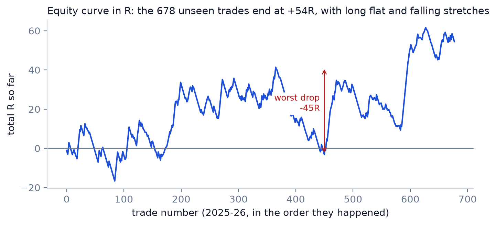

**Why it looks like this.** The line ends up (+54R), but the road is rough. There are long stretches where it goes down. The worst drop was about **−45R** from a high point. That is 45 times the loss of one stop. If 1R is $35, that is about −$1,560 before it recovered. A real trader must be able to survive this.

## 5.8 The Monte Carlo chart

See section 4.15. The horizontal axis is the total profit or loss after 20 trades. The height of each bar is how many of the 10,000 runs ended there. The red dashed line is the bad case (5%), the black is the middle, the green is the good case (95%).

**Why it is a "hill".** Most runs end near the middle. Very bad and very good runs are rare. The hill is wide because 20 trades are few: luck still matters a lot.

## 5.9 Results by year

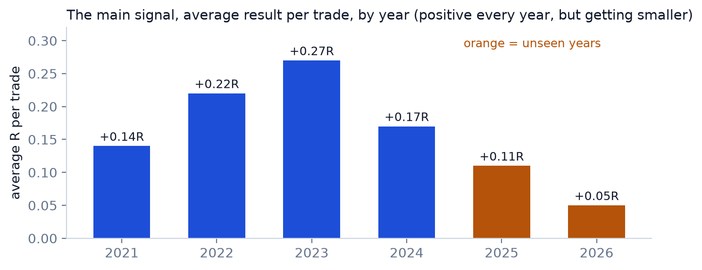

**What it shows.** The main signal's average R per trade in each year. Blue years (2021–24) were used to choose the method. Orange years (2025–26) were never used.

**Why the bars get smaller.** Markets change. Other traders find the same patterns. An edge that is +0.27R in one year can shrink to +0.05R a few years later. This is normal in markets, and it is why the platform keeps testing live.

## 5.10 Small-sample ranges

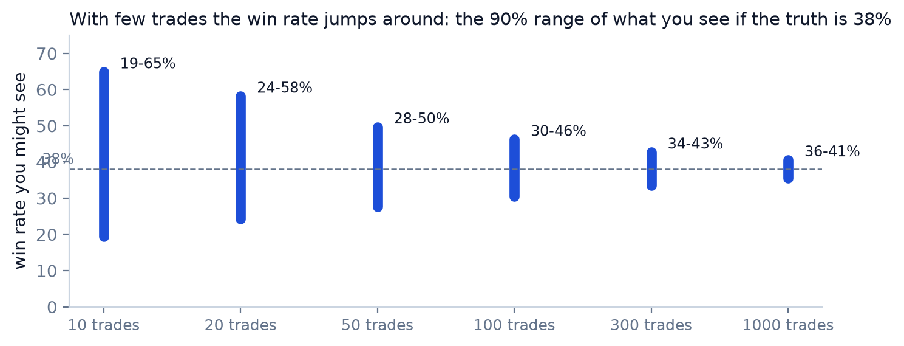

**What it shows.** Suppose the true win rate is 38%. After only 10 trades, you could easily see anything from about 19% to 65%. After 100 trades, about 30% to 46%. After 1,000 trades, about 36% to 41%.

**Why the platform shows a range.** So you do not get too happy after 5 wins, or too sad after 5 losses. The Live results page shows this range ("Real win rate could be 19%–65%").

## 5.11 The trend-score bar (Markets)

A short blue bar with a number from 0 to 100. A full bar = the coin ranks at the top on trend signals. It is the coin's *rank among the other coins*, not a price target.

# 6. How the machine was built and tested

This chapter explains, in plain words, where the main signal comes from and why you can (a little) trust its numbers.

## 6.1 The data

- Daily candles of **591 Binance coins**, from August 2017 to November 2026.
- **Including coins that were later delisted.** This matters. If you only test coins that still exist, you only test the survivors, and every strategy looks better than it is (this mistake is called "survivorship bias").
- The engine trades only **liquid coins**: about $5M or more traded per day, with at least 90 days of history. That is about 295,000 coin-days.

## 6.2 What the model reads

For every coin and every day, about 100 numbers:

- **Market and factors:** momentum (how much it went up or down over 7, 28, 90 days), volatility, volume, funding, its link to BTC, and the whole market (BTC's trend, how many coins are going up).
- **21 technical indicators:** price compared to its 3-, 5-, 10-, 20- and 100-day averages; volume compared to its averages; RSI, Stochastic, MACD, Bollinger bands, CCI, Chaikin money flow, and others.
- **Learned chart patterns:** every coin's last 30 days as a shape. The computer finds the 50 most similar shapes in the past (from 606,000 charts) and checks what happened next.

Everything is **causal**: on each day, the model sees only what was known on that day. A test changes every candle *after* a day and checks that nothing up to that day moves.

## 6.3 The 18 plan models

A **plan** is: side × stop size × target.

- Side: long or short.
- Stop: 0.75, 1.5 or 2.5 ATR.
- Target: 1.5R, 2R or 3R.
- Time limit: 14 days.

That gives 2 × 3 × 3 = **18 plans**. For each plan there is one model (a **LightGBM** model; see glossary). It learns from history: *"on a day that looks like this, how many R does this plan make on this coin, after fees?"*

## 6.4 The decision: one coin a day

Every day the engine has 18 forecasts for each of about 40 coins. It must pick one. It tried **8 decision rules**. The one chosen:

> Score = the coin's predicted R **minus** the median predicted R of the same plan on the other coins that day. Take the single best coin. Never pick a coin whose ATR is above 25%.

In words: pick the coin that **stands out most from the rest of the market** today. Not the coin with the highest forecast in absolute terms (a high forecast alone was not a good signal; see 4.2).

## 6.5 Walk-forward testing and unseen years

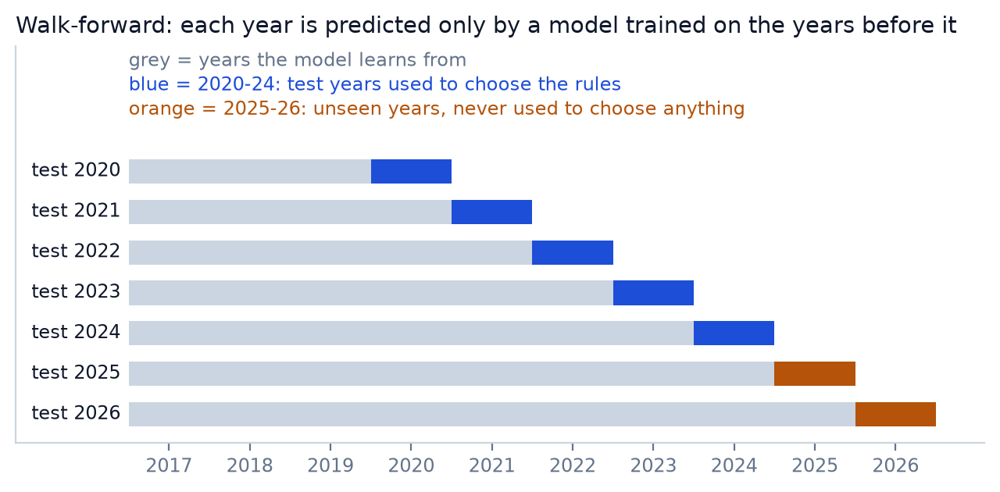

**Walk-forward** means: to predict 2022, the model is trained only on 2017–2021. To predict 2023, only on 2017–2022. And so on. The model never sees the future when it makes a prediction. Between training and testing there is also a **15-day gap** (a "purge"), so a trade that was still open cannot leak its result into training.

The years are used in two different ways:

| Years | Used for | Called |
|---|---|---|
| 2020–2024 | Choosing everything: the decision rule, the settings | Selection years |
| 2025–2026 | Nothing. Only to report the result as it came out | Unseen years (out-of-sample) |

**Why this matters.** If you try many ideas and keep the best one, the best one always looks great on the data you tried it on. That is partly luck. The only honest test is on data that was *never used to choose*.

## 6.6 The results

**The main numbers (unseen 2025–26, 678 trades):**

| Measure | Result |
|---|---|
| Average per trade | **+0.08R** |
| 90% range of the true average | −0.06R to +0.23R |
| Share of trades that made money | 38% |
| Average winning trade | about +1.8R |
| Average losing trade | about −0.9R |
| Random liquid coin, same plan, same days | −0.06R |
| Shorts (172 trades) | +0.46R, 51% won |
| Longs (506 trades) | −0.05R, 33% won |

**By year:** 2021 +0.14R · 2022 +0.22R · 2023 +0.27R · 2024 +0.17R · 2025 +0.11R · 2026 +0.05R. Positive every year, but fading.

**As a paper account** (risking 0.5% of the account per day): 2025–26 grew about **+14.6% a year**, with a worst drop of **−20.1%**, Sharpe 1.04. On the selection years 2020–24: +42.1% a year, worst drop −24.0%, Sharpe 2.41. The big difference between these two periods is normal: the selection years always look better.

**The 90% range** (−0.06R to +0.23R) was made by **bootstrap**: the computer resampled whole weeks of trades thousands of times to see how much the average could move by luck. Because the range includes zero, it is possible the true edge is zero.

**The platform's verdict:** *tested edge, small, its range includes zero, and fading in 2026.*

## 6.7 The 8 rules, and why the rule was not changed

| Rule | 2020–24 (selection) | 2025–26 (unseen) |
|---|---|---|
| edge, top 1, no bar (**chosen**) | +0.199R | **+0.080R** |
| edge, top 3, no bar | +0.160R | +0.140R |
| edge, top 1, with bar | +0.112R | +0.150R |
| edge, top 3, with bar | +0.081R | +0.274R |
| raw, top 1, no bar | +0.072R | +0.210R |
| raw, top 3, no bar | +0.054R | +0.252R |
| raw, top 1, with bar | −0.005R | +0.220R |
| raw, top 3, with bar | +0.010R | +0.349R |

("edge" = predicted R minus the other coins' median; "raw" = predicted R alone; "top 3" = three coins a day; "bar" = only trade when the score beats the past year's median top score.)

**Every rule made money on the unseen years.** But the order flipped: the rule that was best on 2020–24 was the weakest on 2025–26.

**Why the team did not switch to the best unseen rule (+0.349R).** Because then the unseen years would become selection years. The +0.349R would be a "best of 8" number and would be too optimistic, exactly like before. There would be no honest test left. So the chosen rule stays, and the **live test** (chapter 7) is now the judge.

## 6.8 Ideas that were tested and rejected

**35 trading "concepts" as inputs.** The team coded 35 ideas that human traders use: market structure (BOS, CHoCH), premium/discount, liquidity sweeps, equal highs/lows, fair value gaps, displacement, Wyckoff springs and upthrusts, VWAP, candle patterns, moving-average stacks, strength vs BTC, round numbers, and checklists. Then they tested the same engine with and without them:

| | 2020–24 | 2025–26 (unseen) |
|---|---|---|
| With the 35 concepts | +0.170R | +0.047R |
| Without them | +0.199R | +0.080R |

The concepts made the result **worse in both periods**. Why? The model already learns what they measure from price, momentum, volatility and the learned chart patterns. 35 more inputs mostly added noise. So they are switched **off**. The human-style reading (structure, liquidity, Wyckoff) stays with the AI agents, where it is an argument to weigh, not a model input.

**Other things that did not hold up:**

- An older fixed "daily pick" plan whose long edge disappeared when the models were upgraded.
- A "meta-label" filter for the 4h setups (it did not beat simple baselines on unseen data).
- Partial profit (half at +1R, stop to entry): +2 win-rate points, but a lower average trade.
- 21 extra indicators helped only a little (+0.3 to +0.6 points of accuracy on unseen years).

**Meta-labeling on the main signal (tested 26 Nov 2026, rejected).** Meta-labeling means: a second model learns from the first model's own past trades *when its picks fail*, and skips or shrinks those trades. It was tested on the engine's 2,139 past picks, walk-forward, with the policy chosen on 2022–24:

| | 2022–24 (selection) | 2025–26 (unseen) |
|---|---|---|
| Main signal alone, Sharpe | 2.67 | 1.04 |
| With the meta-label filter, Sharpe | 2.97 | **0.48** |

It looked better on the years used to choose it, and worse on the unseen years (+0.039R a trade instead of +0.080R). The filter model barely told winners from losers: AUC 0.52–0.53, where 0.50 is a coin flip. So it was not added. (AUC: see glossary.)

> **Why show the failures?** Because they protect you. If the platform only showed the winners, you could not tell luck from skill.

# 7. Live results

## 7.1 What is saved

- **Every model day**, the platform's **top LONG** and **top SHORT** are saved, whatever their status (TRADE or WATCH ONLY).
- Plus any coin **you** add with "+ Add to signal test".
- The levels are **frozen** at the moment the signal is given: entry, stop, target, and the tight-stop option's stop and target.
- The platform's own signals **cannot be deleted**. Wins and losses stay. Only coins you added can be removed.

## 7.2 How a signal is graded

Every minute, the platform checks the live **1-hour Binance candles** that came *after* the signal. It uses the same rules as the backtest:

| Event | Rule |
|---|---|
| Market entry | Filled at the saved price |
| Limit entry | Filled when a candle reaches it within **48 hours**. Otherwise "not filled" (counts as no win, no loss) |
| Stop hit | **−1R** (minus fees) |
| Target hit | **+3R** for a 3R plan (minus fees) |
| Neither in 14 days | Closed at the price then (a small win or loss) |
| One candle touches both stop and target | Counts as the **stop**. We cannot know which came first, so the platform takes the worse case |
| The candle that fills a limit | Only the stop is checked on that candle |
| Fees | 0.1% of the position, round trip |

The page also tracks the **risky tight-stop option** (stop 0.75 ATR) of each signal separately. For the current engine it is graded over **14 days**, like the main plan. (Rows from the old fixed plan, before 24 Nov 2026, used a 0.5 ATR stop and 5 days.)

## 7.3 Why 10 finished signals before a score

Until 10 signals are finished, the page says: *"3 of 10 signals finished. 7 more to go before the first score."*

After 10, it shows: the share that made money, the average R, the total R, dollars at the safe leverage, the 90% range for the win rate, and what the backtest expected. It also says one of:

- **"working"**: average R is positive and close to (or better than) the backtest's expectation.
- **"making money, but less than the backtest"**.
- **"losing money so far"**.

**Why wins and losses swing in small samples.** Look at chart 5.10. With a true win rate of 38%:

- After 10 trades you might see 2 wins or 6 wins. Both are normal.
- Even with 100 trades, the win rate can show anywhere from 30% to 46%.
- Losing streaks are normal. In the real 2025–26 record, the longest streak was **27 losing trades in a row**.

So 10 trades is only the *first look*. You need about 50–100 finished trades before the live result means much.

> **On 26 November 2026, 0 of 10 signals were finished.** The test started in late November 2026, so there is no live score yet.

## 7.4 The groups on the Live results page

| Group | What it tells you |
|---|---|
| Unified engine / old fixed plan | The current engine (from 24 Nov 2026) vs the older plan it replaced |
| TRADE vs WATCH | Do the trades the rule takes do better than the "watch only" ideas? (They should.) |
| Long vs short | Does the live test confirm "shorts carry it"? |
| Coins you added | Your own picks, graded the same way |
| Machine vs AI agents | The same machine signals split by what the agents said before the trade filled: agreed / said wait / disagreed / not asked |
| The AI agents' own calls | The agents' own graded record. "When they said wait" shows what those skipped trades would have done. If it is red, the agents were right to wait |

**No hindsight.** An agent verdict is attached to a signal only if it was given within 24 hours and **before the trade filled**. The agents must not see the outcome forming.

## 7.5 "Agents as a veto": a rule written before any data

Should the platform skip a trade when the AI agents say WAIT or the opposite side? Nobody knows yet. So a rule was **written down before any live data existed**:

- Wait until **30 finished signals** had an agent verdict.
- Then the agents get a **veto** (their WAIT or opposite call cancels the trade) **only if** both are true:
  1. the "agents agreed" group beats the machine alone by at least **0.15R a trade**, and
  2. the trades they told you to skip **lost money**.
- If not, the agents stay a second opinion.

**Until then, the machine decides and the agents only advise.** The status ("12 of 30 checked", for example) is under "More details" on Live results.

**Why a rule written in advance?** If you decide the rule after seeing the results, you can always find a rule that looks good. Writing it first keeps the test honest.

**Why not backtest the agents instead?** An AI language model has already read the history it would be tested on. Any backtest of it leaks the future. The only fair test is forward, on new trades.

# 8. AI agents and AI cost

## 8.1 Who the agents are

The AI desk works like a real trading desk. There are **9 leads**. Each lead has helpers (23 in total). The work goes in stages:

| Stage | Lead | Job | Helpers |
|---|---|---|---|
| 1. Research | **Atlas**, Research Lead | Plans the questions; gathers facts across timeframes, the whole market and the coin's record. Picks no side yet | Horizon (timeframes), Compass (whole market), Archive (coin record) |
| 2. Analysis | **Vega**, Chief Technical Strategist | Structure, liquidity, momentum, levels, and the price that proves the idea wrong | Keystone (SMC/ICT), Pulse (momentum), Chronos (methods), Bastion (levels) |
| 2. Analysis | **Tide**, Flow & Derivatives Lead | Funding, open interest, long/short ratios, liquidations, news, fear & greed | Torque (positioning), Undertow (order book, liquidations), Echo (news, sentiment) |
| 2. Analysis | **Ledger**, Fundamentals Lead | Tokenomics and dilution, usage, valuation, strength vs BTC, BTC dominance, stablecoin supply | Mint (tokenomics), Bedrock (usage, valuation), Beacon (standing) |
| 2. Analysis | **Cipher**, Quant Lead | The computational case: the tested signal, the trained models, chart patterns and the live test, each weighed by its accuracy on unseen years | Gauge (tested plan), Prism (trained models), Mosaic (patterns, live test) |
| 3. Debate | **Raven**, Red Team Lead | Attacks the leading idea with base rates, the desk's own record and a "pre-mortem" (how could this fail?) | Odds (base rates), Mirror (desk record), Fracture (pre-mortem) |
| 4. Plan | **Sentinel**, Risk Officer | Picks the stop and target from real levels; a tool computes size, leverage, margin and the 10x / 20x versions in dollars | Anchor (stop/target), Ballast (leverage, liquidation, costs) |
| 5. Validate | **Verity**, Validator | **Code, not AI.** Checks the data, fills research gaps, fact-checks every number, sends agents back if numbers are not verified | — |
| 6. Decision | **Apex**, Head Trader | Hears a bull case and a bear case, reads the validation report, decides **LONG, SHORT or WAIT** | Bull Case, Bear Case |
| 7. Learn | Journal | Records the call and grades it later on the candles | — |

## 8.2 When they run

- **Only when you press the button**: "Run AI agents" on Today's signal, or the run button on the AI desk.
- Nothing runs by itself. (Before version 0.44, the 4h setups page could start runs on its own and spend credits. This was fixed.)
- A run takes about **3–5 minutes**.
- The verdict is saved for that coin. It shows on Today's signal, on Home and on the desk's Best signal card for **24 hours**, then it is marked "old, run again".
- **The agents see the same evidence as you.** Their tools include the trained model's plan and the simulation (the model's past picks on this side, plan and coin). So they reason from the same numbers the trader sees.

## 8.3 Why the agents often say WAIT

The agents are built to be careful. Verity, the validator, is code and cannot be talked out of a failure. Some of its checks:

- Reward/risk must be at least 2 after fees. Costs must be under 20% of the risk.
- At least 3 independent kinds of evidence must support the side.
- The side should not fight both the chart reading and the higher timeframe.
- The liquidation price must be at least 1.5× further than the stop.
- Data must be fresh, and the live price close to the analysed price.

If a **critical** check fails, the Head Trader's LONG or SHORT is turned into **WAIT**, and the page says which check blocked it.

The agents also look at things the machine does not use: the 1-hour and 4-hour chart, news, order books, and human concepts like market structure. So it is normal that they sometimes disagree with the machine. The Live results page will show, over time, whether listening to them helps.

## 8.4 AI credits: what they are

The agents use an AI service (by default OpenAI GPT-5.5; Claude models can also be set up). You pay that service for **tokens**. A token is a small piece of text, about 3–4 letters. Everything the agents read (input) and write (output) is counted in tokens.

**List prices per 1 million tokens, as set in the platform:**

| Model | Input | Cached input | Output |
|---|---|---|---|
| GPT-5.5 | $5.00 | $0.50 | $30.00 |
| Claude Opus 5.5 | $4.00 | $0.20 | $20.00 |
| Claude Sonnet 5.5 | $2.00 | $0.10 | $10.00 |

**Cached input** is text the AI already read recently (for example the same instructions). It is much cheaper. The AI's hidden "reasoning" is billed as output.

## 8.5 How the cost is estimated

For every AI call, the platform takes the token counts that the AI service returns and multiplies them by the prices above:

> cost = (new input tokens × input price + cached tokens × cached price + output tokens × output price) ÷ 1,000,000

**Example (made-up numbers, GPT-5.5):** a run reads 400,000 tokens, of which 300,000 are cached, and writes 30,000 tokens.

- New input: 100,000 × $5 ÷ 1,000,000 = $0.50
- Cached input: 300,000 × $0.50 ÷ 1,000,000 = $0.15
- Output: 30,000 × $30 ÷ 1,000,000 = $0.90
- **Total ≈ $1.55 for that run**

Your real cost per run is shown on the card ("Last AI-agent runs · about $X a run") after your first runs.

## 8.6 The AI credits card (Settings → AI usage)

Home shows only a small tile with the balance left. The full card is in **Settings → AI usage**.

- **Balance left.** You type the balance you see on your AI provider's billing page (for OpenAI: platform.openai.com → Settings → Billing). A normal API key cannot read the balance, so the platform cannot read it for you. From then on it subtracts the estimated spend.
- **Used bar.** Blue normally, amber above 70% used, red when the balance is low (under 10% of what you entered, or under $1).
- **≈ AI-agent runs left** = balance left ÷ the average cost of your past runs.
- **Today / 7 days / 30 days:** dollars, number of calls, tokens.
- **Spend per day** bars (section 5.4), **by feature** (research desk, chat, and others) and the **last runs**.

> **This is an estimate.** The bill on your provider's page is the truth. It may add taxes or other charges. Update the balance from time to time.

**When the credits run out:** the AI agents stop. The machine model, the simulation, the leverage table and the Live results **keep working**. They need no AI key.

# 9. Risk and leverage rules for a 20x trader

## 9.1 Leverage does not make you more right

Leverage changes two things only:

1. **How many dollars** you win or lose for each 1% the price moves.
2. **Where your liquidation price** is.

It does **not** change the chance that the trade works. A 38% trade at 1x is a 38% trade at 20x.

## 9.2 Liquidation math

On Binance Futures with **isolated margin**, a position is liquidated after roughly this move against you:

> liquidation distance ≈ 1 ÷ leverage − maintenance margin rate

The platform uses maintenance margin: BTC 0.4%, ETH 0.5%, other coins 1%. (Binance's real number uses the mark price and tiers by position size. Always check the liquidation price Binance shows you before you confirm.)

| Leverage | Liquidation distance (altcoin) | Largest safe stop (liquidation ≥ 1.5× stop) |
|---|---|---|
| 2x | 49% | 32.7% |
| 3x | 32.3% | 21.6% |
| 5x | 19% | 12.7% |
| 10x | 9% | 6.0% |
| 15x | 5.7% | 3.8% |
| 20x | 4% | 2.7% |
| 25x | 3% | 2.0% |
| 50x | 1% | 0.7% |

For BTC at 20x: liquidation about 4.6% away, largest safe stop about 3.1%.

**How to use this table.** First look at the stop distance on Today's signal. Then find the highest leverage whose "largest safe stop" is bigger than your stop. That is your max.

**Example:** the main plan's stop is 7.1%. In the table, 5x allows 12.7% ✓, 10x allows only 6.0% ✗. So the max is between 5x and 10x (the exact answer from the formula is 8x). At 20x you need a stop under 2.7%. The main plan's stops are almost never that tight. Only the tight-stop option comes close.

## 9.3 Always isolated margin

- **Isolated margin:** only the margin you put on *this* trade can be lost. If it is liquidated, the rest of your account is safe.
- **Cross margin:** your whole futures balance supports the trade. A bad trade can eat money that was meant for other trades.

The platform's numbers all assume **isolated** margin. Use isolated.

## 9.4 Position sizing: decide your dollar risk first

Most 20x traders think: "I put $100 and use 20x." That makes the position $2,000, and the stop decides the loss, or the liquidation does.

A safer way, in 3 steps:

1. **Choose your risk in dollars** (what you lose if the stop hits). Many traders use 1–2% of the account.
2. **Position size = dollar risk ÷ stop distance.**
3. **Margin = position size ÷ leverage.** Pick a leverage that keeps the liquidation behind the stop.

**Example:** account $1,000. Risk 2% = **$20**. Stop 7.1%.

- Position = $20 ÷ 0.071 = **$282**.
- At 3x: margin $94. At 5x: margin $56. Either way, the loss at the stop is about $20.
- At 20x the margin would be only $14, but liquidation (4%) comes before the stop (7.1%). **Not allowed.**

**Example with the tight stop (3.6%):** position = $20 ÷ 0.036 = $556. At 10x, margin $56, liquidation 9% away: safe.

> **See the key point:** with the same $20 risk, leverage only changes how much margin is locked. Your loss at the stop is the same. Higher leverage is not "more profit"; it is "less margin used", with a closer liquidation.

## 9.5 The Risk manager: who picks your risk

On Portfolio, the **Risk manager** chooses how much of your account is at risk on each trade. It is **code, not an AI**: the same facts always give the same answer, and every reason is written in plain words. It reads only measured evidence: the main signal's **live** record, your own account (drop from the peak, losing streak), today's status (TRADE or watch only) and the AI agents' stance.

| Mode | Risk per trade | When |
|---|---|---|
| **Conservative** | 1% of the account | The start. Stays until the live record proves itself |
| **Growth** | 2% | 10+ finished live signals averaging +0.10R or more, account within 10% of its peak, fewer than 3 losses in a row, and the agents not saying wait or the other side |
| **Aggressive** | 3% | 30+ finished live signals averaging +0.20R or more, the agents' veto test passed, the agents agreeing today, and the account within 5% of its peak |

**Smaller or no trade:**

- **Half size (0.5%)** after 3 losses in a row or a 10% drop from the peak.
- **Half size** when the agents say wait.
- **No new trade** when the agents say the other side, when the signal is watch only, when the account is 20% below its peak (take a break), or when your open trades already use the mode's open-risk limit (Conservative 4% of the account, Growth 10%, Aggressive 18%).

**How it sizes the trade:** position = dollar risk ÷ (stop % + fees). Then it picks the **lowest leverage** that keeps the margin within the mode's per-trade limit (Conservative 30% of the account, Growth 40%, Aggressive 50%), and never above the signal's safe maximum.

**Example (26 Nov 2026, a $1,000 account):** Conservative, at half size because the agents said wait → 0.5% = **$5 at risk**. Stop 7.07% away → position ≈ $5 ÷ 7.17% ≈ **$69.77**, at **1x**. Loss at the stop **−$5**, win at the take profit **+$14.72**. The same trade at 5x needs only about $14 margin, and the loss at the stop is still $5.

**Why 1% to start?** A losing streak of 10 trades happens (the test had one of 27). At 1% a trade, 10 losses cost about 10% of the account. At 20% a trade, they would wipe it out.

## 9.6 Why tight stops get hit often

- Price does not move in a straight line. It wiggles. The **ATR** tells you how much it wiggles in a normal day.
- A stop at 0.75 ATR is *inside* one normal day's wiggle. Many trades are stopped out by noise, then the price goes the right way without you.
- In the 2025–26 test: 0.75 ATR stops won 34% of trades; 1.5 ATR stops 38%; 2.5 ATR stops 46%.
- Wicks: a fast move of a few seconds can reach your stop. Binance's **mark price** can also be a bit different from the last price you see.
- **Funding:** every 8 hours, longs pay shorts (or shorts pay longs). At high leverage, funding is a bigger share of your margin.

## 9.7 Losing streaks and drawdowns

With a 38% win rate, long losing streaks are **normal**:

- In 100 trades, a streak of 8 or more losses in a row happens in about **6 out of 10** cases. A streak of 10 or more in about **1 out of 4**.
- In the real 2025–26 record, the longest losing streak was **27 trades**. The worst drop was about **−45R**.

**What this means at 20x.** If every trade risks $73 (the tight-stop plan at 20x with $100 margin), 10 losses in a row is about −$730. If you size so that one loss is a big part of your account, a normal losing streak can end your account before the winners come.

## 9.8 About "20% a trade"

Some trades on the plan give a lot: at 5x, the main plan's target is about **+100% of your margin** (+$103 on $100). But the average trade is much smaller. At 5x with a 7% stop (1R ≈ $36), the tested average of +0.08R is about **+$2.90 a trade**, or about **+3% of margin** per trade, over many trades, with long losing streaks on the way.

No honest test on this platform shows +20% of margin per trade on average, or a 90% win rate.

## 9.9 Checklist before you place an order

The full step-by-step version, with a printable page, is in chapter 10.

1. Is it the **main signal** (Today's signal), not a Lab page or a chart arrow?
2. Is the status **TRADE**, not WATCH ONLY?
3. What do the **three opinions** say? If "They disagree", skip. If "Machine yes, agents wait", use a smaller size or wait.
4. **Market or limit?** If limit, place a limit order. Don't chase.
5. Has the price already reached the **stop** before you enter? Then cancel.
6. Your **dollar risk**: is the "If stop hits" number a loss you truly accept?
7. **Leverage**: at or below max safe. Never a row that says "liquidated before stop".
8. Margin mode: **isolated**.
9. Put the **stop order on Binance at the same time** as the entry. Do not keep it only in your head.
10. Compare Binance's **liquidation price** with your stop. Liquidation must be clearly further away.
11. Put the **target** order (take profit) as planned. Set a reminder for the **14-day** time limit.
12. Do not move the stop or take profit early. The plan was tested as it is.

# 10. How to place a trade and manage it

This chapter is the practical part: step by step, from reading the signal to closing the trade. It is for **Binance USDⓈ-M Futures** with **isolated margin**.

> **Remember.** The platform never places orders. You place every order yourself on Binance. Paper first is always fine. No signal here wins 90% of the time. Leverage makes losses grow exactly as fast as gains.

## 10.1 Before the trade: read and decide

1. **Open Today's signal** (or Home). Read the **side** (LONG / SHORT) and the coin.
2. Check the status: **TRADE** (green, "good to trade"). If it says **watch only**, **no clear side** or **Not tradeable now** (stop already hit, target already hit, moved away · too late), do not trade it (section 4.17).
3. Check the **entry type**: "market" (enter now) or "limit" (wait for that price). Limits only appear when the price already ran more than 0.33 ATR; never chase.
4. Write down the **stop loss**, the **take profit** and **"hold up to 14 days"**.
5. Read the **final reading** of the three opinions (picture 2.4):
   - green "both say …": the normal size;
   - amber "machine yes, agents wait": the Risk manager already halves the size; you may also wait for the agents' condition;
   - red "they disagree": no trade today.
6. Check **News** for big news about this coin (picture 2.13).
7. **Decide your dollar risk first.** Open **Portfolio → Today's plan** (picture 2.15). It shows the risk the Risk manager chose ("If the stop hits −$5") and the size for your account. Ask yourself: "Is this a loss I accept calmly?" If not, skip.

## 10.2 Placing it on Binance

These steps follow the Binance Futures screen. Button names can be a little different in your Binance app version; the idea is the same.

1. Open **Futures → USDⓈ-M** and search the coin (for example **WLFIUSDT**, the perpetual).
2. **Margin mode: Isolated.** Tap the mode button (it may say "Cross") and choose **Isolated**. Never cross.
3. **Leverage:** tap the leverage button (for example "20x") and set the number from **Today's plan**. Never above the page's safe maximum.
4. **Order type:** choose **Market** if the plan says market, or **Limit** if it says limit (type the limit price exactly).
5. **Quantity:** type the **quantity of coins** from Today's plan (it is shown under "Put in (margin)"). Then check that Binance's "Cost" (your margin) is about the same as "Put in (margin)".
6. **Tick "TP/SL"** and type:
   - **Take Profit** = the plan's take profit price;
   - **Stop Loss** = the plan's stop loss price.
   Use the same trigger type every time (the platform grades on the normal price candles, so "Last price" matches its test; "Mark price" avoids some fast wicks. Pick one and keep it).
7. Press **Sell/Short** for a SHORT, or **Buy/Long** for a LONG.
8. Open the **Positions** tab. Check three things:
   - the size and the entry price are right;
   - the **TP/SL** column shows both prices;
   - Binance's **Liq. price** is **further away than your stop** (above the stop for a short, below the stop for a long). If it is not, close the trade and use less leverage.
9. If you used a **limit** order: it sits in **Open Orders** until filled. Set a reminder for **48 hours** (see 10.4).

### Worked example: today's signal at 5x with $100 margin

Real numbers from the platform on 26 November 2026 (WLFI/USDT SHORT). This example uses the "$100 at 5x" money line, not the Risk manager's size, so you can compare with the screens.

| Step | What you type or check | Number |
|---|---|---|
| Side | Sell/Short | SHORT |
| Margin mode | Isolated | — |
| Leverage | 5x (safe maximum is 8x) | 5x |
| Order type | Market (the plan says market) | about 0.0423 |
| Position | $100 margin × 5 | $500 |
| Quantity | $500 ÷ 0.0423 | about 11,820 WLFI |
| Stop Loss | the plan's stop (+7.1% above entry) | 0.045289 |
| Take Profit | the plan's take profit (−21.2% below entry) | 0.033332 |
| Liquidation (platform estimate) | must be above the stop | about 0.0503 (19% away) |
| If the stop hits | $500 × 7.07% + fees | about −$36 |
| If take profit hits | $500 × 21.2% − fees | about +$105 |

At **20x** the same $100 would make a $2,000 position. The liquidation would be about 4% away, **before** the 7.1% stop. You would lose the whole $100. That is why the page says "liquidated before stop" for 15x and 20x.

> **The Risk manager's size is smaller.** For a $1,000 account, on this day it chose 0.5% risk ($5): a $69.77 position at 1x (picture 2.15). Same coin, same stop, same take profit; just a smaller size. Both are correct ways to place the trade. The Risk manager's size is the safer one.

## 10.3 Recording it on the platform

**After** the order is placed on Binance, go to **Portfolio**. There are three ways to record it:

1. **"Accept as suggested"** (Today's plan): you placed exactly the suggested order (same margin and leverage). The trade is added to **Open trades** with today's numbers.
2. **"Accept with my numbers"** (Today's plan): you placed today's signal, but your fill price, margin, leverage or time was different. A form opens with the plan filled in; correct it to what you really did, then save (picture 2.19).
3. **"+ Add a trade"** (Open trades): any other trade you placed. Type the coin, side, entry fill, margin, leverage, stop, take profit and the time you opened it. The form shows the position, the loss at the stop, the gain at the take profit and the liquidation as you type. It **warns** you in red when the liquidation comes before your stop, and in amber when the stop would risk more than 3% of your account.

If you decided not to trade, press **"Skip today"**.

**"Let the AI plan one"** is a different thing: the AI agents plan a new trade for you. It **uses AI credits**. You don't need it to record a trade.

> Never press Accept for a trade you did not place. The record is your real history; it is used by the Risk manager (losing streaks, drop from the peak).

**What the platform then shows every day** (Open trades card): the live price ("Mark"), your profit or loss in dollars, in % of margin (ROE) and in R, the liquidation price and its distance, the risk left at the stop, the day count, and **one line with the next action** (for example "Hold. Stop … target …", or "Stop was touched: if Binance did not close it, close now and record the exit").

> **For a trade from Today's plan, the card follows the main plan.** The target is labelled **"Take profit (all)"**: one take profit closes the whole position, and there is no partial close. The advice line reads like *"Hold. Stop …, take profit … Don't move the stop or close part of it: the plan was tested this way, day N of 14."* It tells you to close when the stop or the take profit is touched, or at 14 days. Your Binance TP and SL orders do the closing; then press **"I closed it"** and type the exit price. (Trades from the Lab system account keep that system's own rules.)

## 10.4 Managing it until it closes

1. **Limit not filled in 48 hours → cancel it** (Open Orders → Cancel). Also cancel if the price reaches the stop before your limit fills. A new signal comes every day.
2. **Do not move the stop.** Never widen it, never remove it. The plan was tested with this stop.
3. **One target, no partial close** (main plan). Let the Binance TP order do the work.
4. **14-day limit:** count from the fill. If neither the stop nor the take profit hit in 14 days, **close at market** and record it.
5. **If tomorrow's signal is different** (another coin, or even the other side on the same coin): your open trade keeps its own plan. Do not flip or close it because of a new signal. Each signal is graded on its own plan.
6. **If the AI agents later say WAIT:** the agents only advise; the veto rule is not active (chapter 7.5). Keep the plan. If you feel you must reduce risk, it is your decision, but the test no longer applies.
7. **Funding fees:** every few hours (usually every 8 hours) longs pay shorts, or shorts pay longs. Binance shows the rate and a countdown at the top. Over 14 days it adds up. Example: funding of −0.1% every 8 hours against you on a $500 position is about −$1.50 a day, or −$21 over 14 days. That is more than half of a $36 stop. If funding is large and against you, take it into account.
8. **Check once a day, not every minute:**
   - Binance **Positions**: is the position still open, are the TP and SL orders still there?
   - Platform **Portfolio**: the next-action line.
   - Platform **Live results**: the same signal, graded automatically.
9. **Never add to a losing trade.** Adding to a loser makes the loss at the stop bigger than you planned.
10. **After a stop: no revenge trade.** A stop is a normal part of the plan (6 of 10 trades lose). Do not open a bigger trade to "win it back". Wait for the next signal. The edge only shows over many trades. In the 2025–26 test, the longest losing streak was 27 trades.

## 10.5 After it closes

1. On **Portfolio**, press **"I closed it"** on the open trade (if it is not closed already) and type the exit price and the reason (stop, target, time limit, manual).
2. The trade moves to **Closed trades**, with its profit or loss in dollars and in R. The account value, the win rate, the total, the losing streak and the "below the peak" number update. The **Risk manager** uses them for the next trade.
3. **Compare with Live results.** The same signal is graded there automatically on live candles. Your result should be close. Small differences are normal: your exact fill price, slippage, fees and funding, and the minutes you entered or closed. A big difference means something was different from the plan (for example a moved stop). Learn from it.

## 10.6 Printable checklist

<!-- pagebreak -->

### One-page checklist: place and manage a trade

**Before**

- ☐ Today's signal says **TRADE** (good to trade), not watch only, not "no clear side"
- ☐ Still valid: no "stop already hit", "target already hit" or "moved away · too late"
- ☐ The final reading is **not** red ("they disagree")
- ☐ No big news against this coin (News → today's signal filter)
- ☐ I know the side, entry type (market or limit), stop loss, take profit, 14 days
- ☐ Portfolio → Today's plan: I accept the **"If the stop hits"** loss calmly

**On Binance**

- ☐ USDⓈ-M Futures, the right coin (…USDT perpetual)
- ☐ **Isolated** margin
- ☐ Leverage = Today's plan (never above the safe maximum)
- ☐ Market or Limit, exactly as the plan says
- ☐ Quantity = Today's plan
- ☐ **TP/SL ticked**: take profit and stop loss typed in
- ☐ Positions tab: size, entry, TP/SL shown, **liquidation beyond the stop**

**On the platform**

- ☐ Portfolio → **Accept as suggested**, or **Accept with my numbers** if your fill was different (only after placing it)

**Every day until it closes**

- ☐ Limit still not filled after 48 hours → cancel
- ☐ Stop and take profit orders still on Binance; stop **not moved**
- ☐ Funding not eating the trade
- ☐ Day 14 → close at market
- ☐ No adding to a loser; no new trade on the same coin "to fix it"

**After it closes**

- ☐ "I closed it" on Portfolio (exit price and reason)
- ☐ Compare with the same signal on Live results
- ☐ After a stop: no revenge trade; wait for the next signal

# 11. Crypto A–Z glossary

Each word has: what it is, in one plain sentence, and **why the platform shows it**.

**ATR (Average True Range).** How much a coin moves in a normal day, averaged over 14 days. *Why:* stops and targets are measured in ATR, so they fit each coin's normal movement.

**AUC.** A score from 0.5 to 1 for how well a model separates two groups (for example winners from losers). 0.5 = a coin flip; 1 = perfect. *Why:* the meta-label filter scored only 0.52–0.53, so it was rejected.

**Base rate.** How often something happens with no model at all. *Why:* a model is only useful if it beats the base rate. The simulation shows "this plan, any day, no model".

**Basis.** The price difference between the perpetual future and the spot price. *Why:* it shows if futures traders pay extra to be long (positive) or short (negative). For BTC and ETH it is usually tiny (median about −0.04%).

**Bollinger bands.** Two lines above and below a 20-day average, at 2 standard deviations. *Why:* one of the 21 indicators the model reads (where the price sits inside the bands, and how wide they are).

**Bootstrap.** Resampling the real trades thousands of times to see how much the average could change by luck. *Why:* it makes the 90% range (−0.06R to +0.23R).

**BOS (Break of Structure).** Price breaks the last swing high (in an uptrend) or swing low (in a downtrend), so the trend continues. *Why:* the AI agents and the chart's Guided analysis use it. As a model input it was tested and rejected.

**Breadth.** The share of coins going up. *Why:* the "Whole market" group; when few coins rise, the market is weak.

**BTC dominance.** Bitcoin's share of the whole crypto market value (for example 58.75%). *Why:* when it rises, money flows from altcoins to BTC, which is often bad for altcoins. The Fundamentals Lead reads it.

**Candlestick.** A bar showing the open, high, low and close of one period. *Why:* all charts on the platform use them (see 5.6).

**CHoCH (Change of Character).** The first break *against* the trend, for example a downtrend that breaks a swing high. A possible sign the trend is turning. *Why:* used by the AI agents and the chart drawings; rejected as a model input.

**Cross margin.** Your whole futures balance supports every open trade. *Why:* the platform warns against it; all its numbers assume isolated margin.

**Drawdown.** The fall from the highest account value to a later low. *Why:* it shows the pain on the way. The main signal's worst was −20.1% of a paper account at 0.5% risk a day, or about −45R.

**Edge.** A real advantage that makes money on average over many trades. *Why:* "tested edge" means the advantage held on unseen years.

**Entry.** The price where you open the trade. *Why:* the plan gives one price, market or limit.

**Equity curve.** A line of your account value over time. *Why:* see 5.7.

**Expectancy (average R).** The average result per trade, counting both wins and losses. *Why:* this, not the win rate, decides if a strategy makes money. The main signal: +0.08R.

**Fair value gap (FVG).** A fast move that leaves a "gap" between candle 1's high and candle 3's low; price often comes back to fill it. *Why:* an SMC idea used by the agents; rejected as a model input.

**Fear & greed index.** A 0–100 mood score of the crypto market. *Why:* context on Home and for the agents (see 5.3).

**Fees.** Binance charges a fee on every order: taker about 0.05% (market orders), maker about 0.02% (limit orders that wait in the book). *Why:* all platform numbers include 0.1% of the position for a round trip.

**Funding rate.** A small payment every 8 hours between longs and shorts on perpetual futures. When it is positive, longs pay shorts. *Why:* very positive funding means the crowd is very long (crowded). Shown on Markets per year; also a model input.

**Isolated margin.** Only the margin put on this trade can be lost. *Why:* the platform's leverage table and liquidation prices assume it.

**Leverage.** Borrowed size. 10x means $100 margin controls a $1,000 position. *Why:* the table shows dollars at each leverage; leverage never improves accuracy.

**LightGBM.** A popular machine-learning method that builds many small decision trees, each one fixing the mistakes of the previous ones. *Why:* each of the 18 plan models is a LightGBM model.

**Limit order.** An order at a price you choose; it fills only if the price comes there. *Why:* the plan uses a limit when the price already ran, so you do not chase.

**Liquidation price.** The price where the exchange closes your position and you lose the whole margin. *Why:* the platform checks it is far behind the stop.

**Liquidity sweep.** Price quickly goes past an obvious high or low (where many stop orders are), then comes back. *Why:* used by the agents and drawn on the chart; rejected as a model input.

**Long / short.** Long = you win if the price goes up. Short = you win if the price goes down. *Why:* every signal is one of the two.

**Maintenance margin.** The minimum margin to keep a position open. Below it, you are liquidated. *Why:* it is part of the liquidation formula (BTC 0.4%, ETH 0.5%, others 1%).

**Margin.** The money you put on a futures trade. *Why:* you type it at the top of Today's signal; all dollar numbers follow it.

**Mark price.** A fair price Binance uses for liquidation, based on several exchanges. *Why:* it can differ from the last price, which is one reason for the 1.5× buffer.

**Market order.** An order that fills now at the best price available. *Why:* the plan says "market" when the price has not run away from the model's price.

**Mean reversion.** The idea that a price far from its average tends to come back. *Why:* some indicators (RSI, Bollinger) measure it; the model reads them in "Oscillators & reversal".

**Meta-labeling.** A second model that tries to learn when the first model's picks will fail, to skip them. *Why:* tested on the main signal and rejected (section 6.8).

**Momentum.** Coins that went up recently tend to keep going up for a while (and down for down). *Why:* one of the strongest groups in the model ("Trend & momentum").

**Monte Carlo.** Running thousands of random "possible futures" from past results. *Why:* the simulation table (see 4.15).

**Moving average.** The average price over the last N days. *Why:* the model compares the price to several moving averages; "Market UP/DOWN" uses BTC's 50-day average.

**No clear side.** Shown instead of LONG or SHORT when the model's own forecast for a coin is negative. *Why:* on such coins the past cannot say which side wins (section 4.17), so no direction is claimed.

**Open interest (OI).** The total value of all open futures positions on a coin. *Why:* rising OI with rising price means new money entering; the Flow Lead reads it. Some exchanges report it badly, so it is used with care.

**Out-of-sample.** Data that was not used to build or choose the model. *Why:* the 2025–26 results are out-of-sample, so they are the honest test.

**Overfitting.** A model that learned the noise of the past instead of a real pattern. It looks great on old data and fails on new data. *Why:* walk-forward testing and unseen years are there to catch it.

**Paper trading.** Trades that are only recorded, not real. *Why:* everything on the platform is paper.

**Perpetual (perp).** A futures contract with no expiry date. Funding keeps its price close to spot. *Why:* Binance USDT-M perps are what you trade at 20x.

**Position size.** Margin × leverage. *Why:* the "Position" column in the leverage table.

**Premium / discount.** In SMC, the upper half of a range (premium, expensive) and the lower half (discount, cheap). *Why:* used by the agents; rejected as a model input.

**Purge.** A gap of days between training data and test data so no open trade leaks its result. *Why:* the engine uses a 15-day purge.

**R / R-multiple.** Your result divided by the loss at the stop. −1R = stop hit; +3R = three times the risk won. *Why:* the platform's main unit (see 4.7).

**Random-coin baseline.** The same plan on a random liquid coin on the same days. *Why:* if the model cannot beat this, its coin choice has no value. Main signal +0.08R vs random −0.06R.

**Regime.** The market's current "mood": trending up, trending down, mixed, calm or wild. *Why:* shown on Home; the agents use it.

**RSI (Relative Strength Index).** A 0–100 number of recent up moves vs down moves. Above 70 = stretched up; below 30 = stretched down. *Why:* one of the model's indicators.

**SHAP.** A method that splits one model forecast into the share each input added. *Why:* it makes the "Why — what the model saw" bars.

**Sharpe ratio.** Average return divided by how much the returns swing. Higher = smoother profit. Above 1 is decent. *Why:* the paper account on 2025–26 had 1.04.

**Slippage.** The difference between the price you expected and the price you got. *Why:* market orders and fast markets have more of it; one reason to prefer limits.

**SMC / ICT.** "Smart Money Concepts" and "Inner Circle Trader": a family of chart ideas (structure, liquidity, order blocks, fair value gaps). *Why:* the agents read them; as model inputs they were tested and rejected.

**Stablecoin supply.** The total value of stablecoins (like USDT, USDC). Rising supply can mean new money waiting to buy crypto. *Why:* the Fundamentals Lead reads it (for example $282B, −5.75% in 30 days on 26 Nov 2026).

**Stop loss.** The price where you close a losing trade. *Why:* it defines 1R. Always place it on Binance.

**Survivorship bias.** Testing only coins that still exist, which makes results look too good. *Why:* the platform's data includes delisted coins to avoid it.

**Take profit / target.** The price where you close a winning trade. *Why:* the main plan has one target, usually 3R.

**Volatility.** How much and how fast a price moves. *Why:* it sets the stop size (ATR) and the leverage you can safely use. Coins with ATR above 25% are never picked.

**VWAP (Volume-Weighted Average Price).** The average price paid, weighted by volume. *Why:* traders see it as "fair value"; used by the agents; rejected as a model input.

**Walk-forward.** Testing each year with a model trained only on earlier years. *Why:* it copies real life, where you never know the future (see 6.5).

**Wick.** The thin line above or below a candle's body. *Why:* long wicks can hit tight stops; see 9.6.

**Win rate.** The share of trades that made money. *Why:* shown everywhere, but always next to the average R, because win rate alone can fool you.

**Wyckoff.** An old method that reads accumulation and distribution phases, "springs" (false breaks down) and "upthrusts" (false breaks up). *Why:* used by the agents; rejected as a model input.

# 12. FAQ

### Why only 38% wins?

Because the plan aims for big wins (usually 3R) and accepts small, frequent losses (1R). A far target is hit less often. In 2025–26 the average win was about +1.8R and the average loss about −0.9R, so 38% wins still gave about +0.08R a trade. You need about 35% wins to break even with these sizes. A random coin with the same plan also won 38%, but lost money, because its wins were smaller.

### Why is 20x "not possible"?

At 20x, an altcoin position is liquidated after about a 4–4.5% move against you. The main plan's stop is often 6–8% away. So the exchange would close you before your stop, and you would lose the whole margin. The simulation cannot give an honest number for that, so it shows "not possible". For 20x you need a stop under about 2.7%: look at the tight-stop option, and even there 20x is often "tight".

### Why did the agents say WAIT when the machine said SHORT?

They are two separate opinions. The machine reads daily numbers across all coins. The agents read the coin's own charts (also 1h and 4h), news, positioning and order books, and the validator (code) must pass. On 26 November 2026 the agents liked the short idea but said the chart was neutral, futures positioning was unknown, and the setup's base rates were poor. So they waited for a clear rejection below 0.0432. The page reading "Machine yes, agents wait" means: smaller size, or wait.

### Why did the price data say yesterday?

The model uses daily candles, and a Binance daily candle closes at 00:00 UTC. The model only uses finished days, so "Data to" is usually yesterday's date. The *live price* on the page comes from 1-hour candles, which must be less than 2 hours old. If the live price is not available, the plan uses yesterday's close. If the date is two or more days old, the daily update may have failed: tell whoever runs the server.

### The machine says "expected +1.24R". Why is the real average only +0.08R?

The forecast is used to *rank* coins, not as a promise. The model's single-trade forecasts are noisy. The honest number is the tested average of all its picks: +0.08R.

### Why are shorts so much better than longs?

In 2025–26 the crypto market was weak for long stretches, and the engine found that weaker coins in a weak market fall further. Shorts: +0.46R over 172 trades. Longs: −0.05R over 506 trades. This could change if the market turns. Be careful with longs while BTC is below its 50-day average.

### The page says leverage 2x–5x but max safe is 8x. Which is right?

Both. "Max safe" is the limit where liquidation stays far behind the stop. The 2x–5x suggestion is a calmer choice inside that limit. Never go above max safe.

### Why not add another AI layer to filter trades?

It was tested. A second model (meta-labeling) learned from the engine's own past picks which ones would fail. It looked better on 2022–24 (Sharpe 2.67 → 2.97), but on unseen 2025–26 it was worse (Sharpe 1.04 → 0.48). It could barely tell winners from losers (AUC 0.52–0.53, almost a coin flip). More layers mostly add more ways to fool yourself. The AI agents are tested the honest way instead: forward, with a veto rule written in advance (section 7.5).

### The chart (scanner) says LONG, but the main signal says SHORT. Who is right?

They are two different systems. The chart scanner (a Lab system) reads the shape of one chart on one timeframe. The main signal is one model that compares every coin's daily data, and it was tested on years it never saw. They often disagree. **Only the main signal is tested.** Follow it, or don't trade. The same is true for the 4h setups: when the main signal disagrees, the page says "Main signal disagrees — skip".

### What does "no clear side" mean?

The model's own forecast for that coin is negative, so it does not claim a direction. On such coins the ranked side won in 2021–24 and lost in 2025–26, and the other side did the opposite. Don't trade them.

### Why can't I accept a signal that says "Not tradeable now"?

Because the price already hit the stop, hit the target, or went half the way or more to the target since the signal. The tested trade is over, or it is now a different, worse trade. Wait for the next signal.

### Why trade only #1 if #2–10 also made money?

Because #1 is the **tested rule**: it was chosen on 2020–24 and then checked on 2025–26 without changes. The coins ranked #2–10 are ideas. In 2025–26 several of them also made money, partly because the falling market helped every short. If we now chose a different rule ("take #1–3", "take only High confidence") *because* it looked good on 2025–26, we would be using the unseen years to choose, and the accuracy would be fake: there would be no honest test left (section 6.7). Such a rule can only be adopted after it proves itself on new days.

### Why does the platform suggest 1x when I like 20x?

Because your risk is set in **dollars**, not by leverage. The Risk manager first decides how many dollars you can lose at the stop (for example $5). The stop distance then fixes the position size ($5 ÷ 7.17% ≈ $70). Leverage only decides how much margin you lock for that position: $70 at 1x, $14 at 5x. The loss at the stop is $5 either way. So 1x is not "less profit"; it is the same trade with more margin locked and the liquidation far away. You may use more leverage, up to the safe maximum, if you want to lock less margin. But a 20x position on the same margin is a 20x bigger trade, and with a 7% stop it is liquidated before the stop.

### Can I move my stop to entry, or take profit early?

You can, it is your trade. But then the test numbers no longer apply. The platform tested partial profit (half at +1R, stop to entry): it raised the win rate by 2 points and lowered the average trade.

### Why does the chart (or a Lab page) show a different trade?

The chart's boxes and the 4h setups come from the pattern scanner, a Lab system. Only Today's signal is the main signal.

### Why did the team not switch to the rule that did best on 2025–26?

Because choosing by the unseen years would make them "seen" years, and the result would be too optimistic. There would be no honest test left. The live test now decides.

### Live results shows "0 of 10". When will I know if it works?

The first score comes after 10 finished signals (two are saved each day, but some take up to 14 days to finish and some limits never fill). A first look after about 10; a real answer only after 50–100.

### Should I take every signal, or choose?

The tested result is an average over *every* pick. If you choose only some, your results can be very different (better or worse). If you trade it, size small enough to take many trades.

### Why "No trade today"?

No coin passed the rule (for example, every forecast was negative, or the engine found no edge). The page shows the best idea for your watch list. Waiting is a position.

### Where did the AI credits card go?

Home shows a small tile with the balance. The full card (balance, spend per day, per feature, per run) is in Settings → AI usage.

### Do I need to log in?

No. There is no login. Everything is stored on this computer. Your balance and trades are on Portfolio.

### What happens when my AI credits run out?

The AI agents stop. Everything else (machine model, simulation, leverage table, Live results) keeps working.

### Can the platform trade for me on Binance?

No. It is paper only. It never asks for exchange keys and cannot send orders. You place every order yourself.

# Where the numbers come from

All numbers in this guide come from the platform itself (version 0.44, 26 November 2026):

- The engine's tested record: 2025–26 unseen years, 678 trades, as of the data to 23 November 2026.
- The worked example: Today's signal of 26 November 2026 (data to 25 November): WLFI/USDT short, $100 margin.
- The win/loss sizes, losing streak and equity curve were computed from the engine's saved out-of-sample trades.
- Liquidation and safe-leverage formulas: the platform's own risk code (isolated margin, BTC 0.4%, ETH 0.5%, others 1% maintenance).
- AI prices: the list prices set in the platform's cost tracker.
- Screen pictures: taken from the running app on 26 November 2026 (read-only: no button that saves or spends was pressed). The "Today's plan" picture uses an **example $1,000 account**, not your data.

Numbers change as new data arrives. When this guide and the screen disagree, the screen is newer.

> **Decision support, not financial advice.** Paper only. You place and manage every order yourself.
